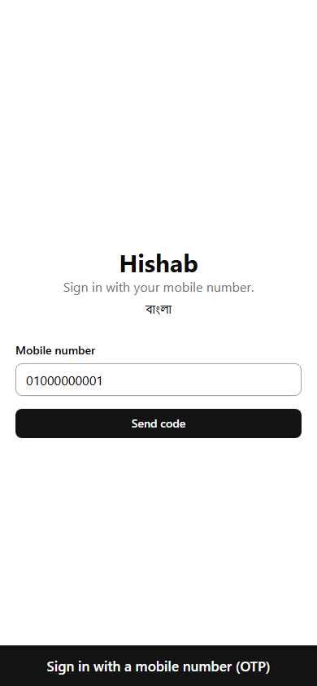
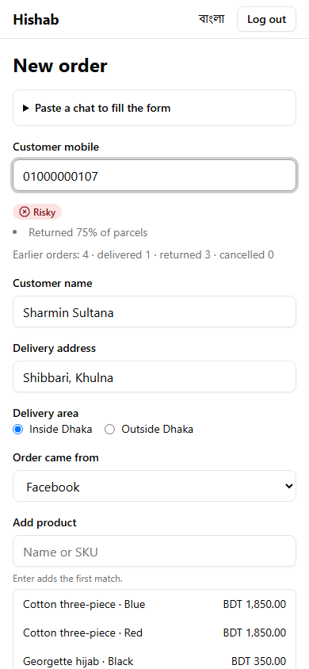
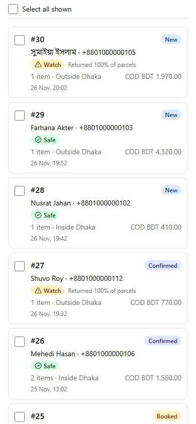
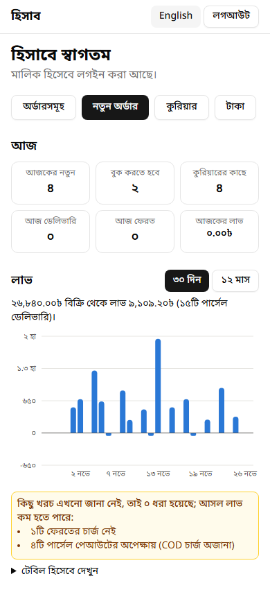
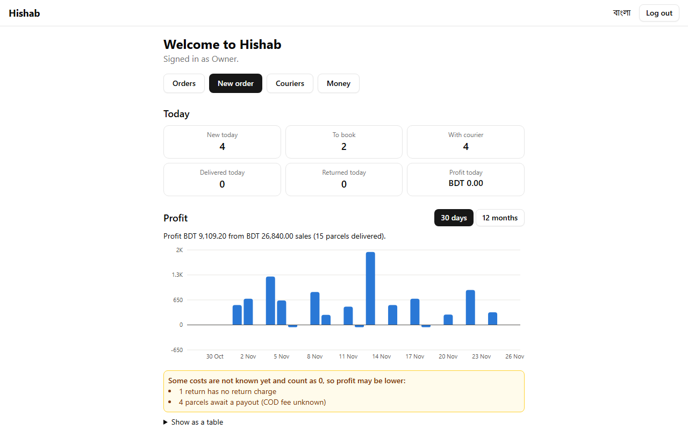
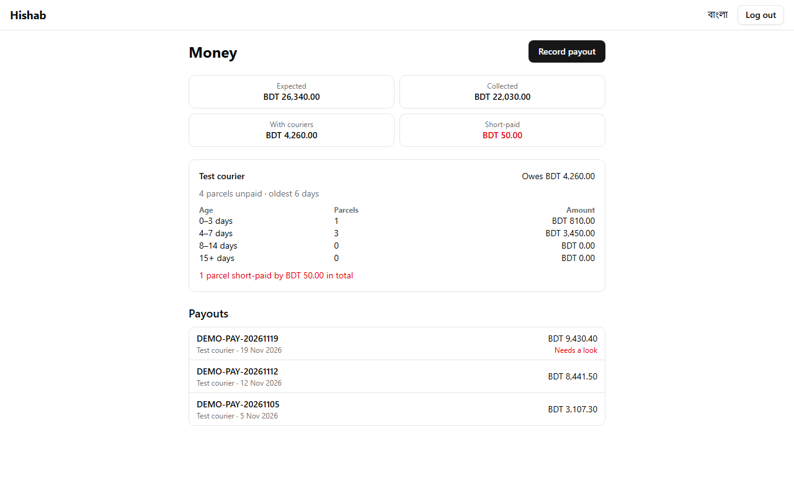
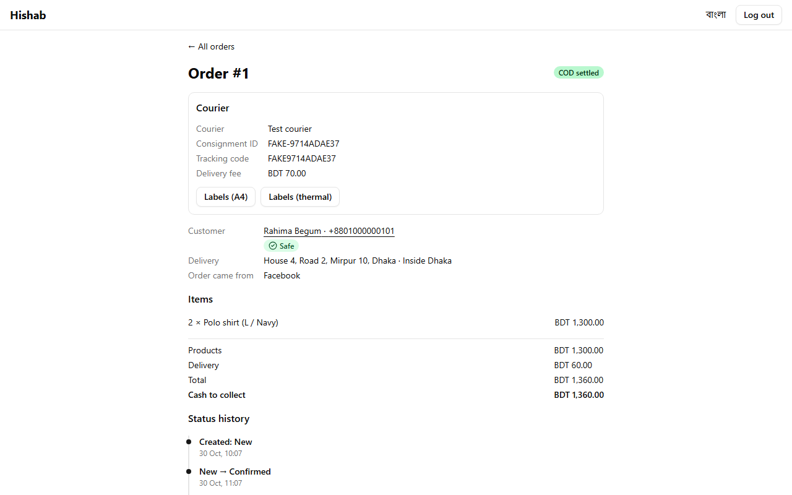
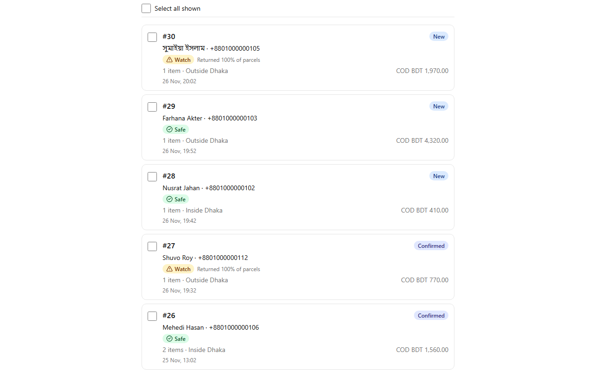
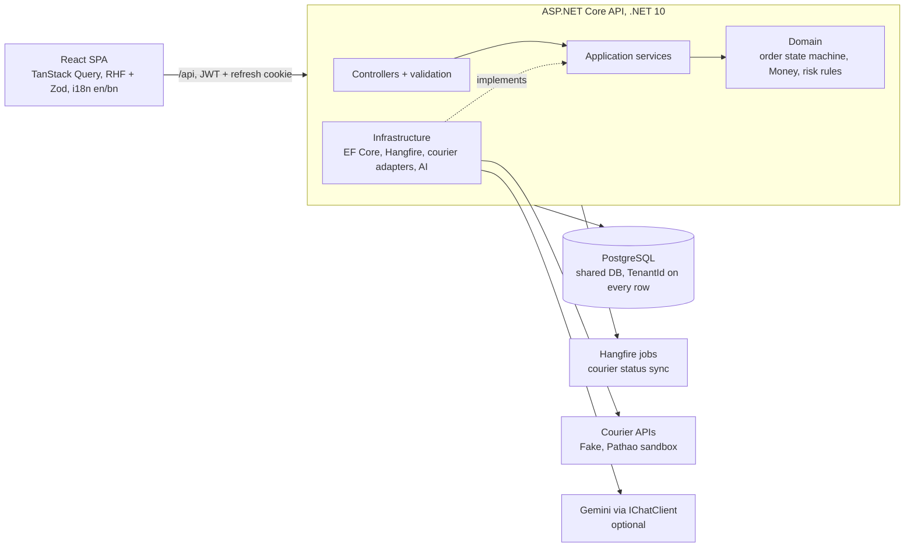

# Hishab

[](https://github.com/IamBishal29/hishab/actions/workflows/ci.yml)
[](LICENSE)


**The back office for Facebook and Instagram sellers in Bangladesh.** Take an order in 20 seconds, book the
courier in one click, spot buyers who refuse parcels, and match every taka of cash on delivery (COD) the
courier pays back.

<p align="center">
  
</p>

## The 60-second tour

Most small online shops in Bangladesh sell through Facebook pages and Messenger, ship with couriers such as
Pathao or Steadfast, and get paid cash on delivery. They run on notebooks and spreadsheets, and lose money in
three places. Hishab closes each one:

| Where money leaks | What Hishab does |
| --- | --- |
| Slow order entry, mistyped phone numbers | A phone-first quick order form: a returning buyer's name, address and history fill in by themselves. Optionally, paste a Messenger chat and an AI fills the form, marking every suggestion until a person checks it. |
| Buyers who refuse parcels (the seller pays delivery both ways) | A risk badge from the buyer's own history (Safe, Watch or Risky, with the reason), shown before the order is taken. |
| COD the courier keeps or short-pays | Bookings through the courier's API, statuses synced in the background, and payout statements pasted in and matched parcel by parcel: settled, short-paid or flagged. |

Also: an owner dashboard with real profit (product cost, delivery, return and COD fees), staff roles, printable
labels and invoices, CSV export, and a full Bangla interface.

## Screenshots

| Quick order: a returning risky buyer | Orders with risk badges | Dashboard in Bangla |
| --- | --- | --- |
|  |  |  |

| Owner dashboard | COD money: what couriers owe |
| --- | --- |
|  |  |
| **Order detail with its full history** | **Order list** |
|  |  |

All data comes from the fictional demo shop; every phone number is in a block no operator has issued
(`+880 10 0000 0xxx`). A script regenerates these images, so they always match the current UI.

## Architecture

A **modular monolith**: one ASP.NET Core API and one React SPA, with Clean Architecture layers inside and a
feature folder per module (Shops, Orders, Customers, Couriers, Money, Products, Reports). One deployable is the
right size for a product at this stage; the module seams keep a later split possible.



- **Multi-tenant** in one database: every tenant-owned row carries `TenantId`, enforced by EF Core global query
  filters and a cross-tenant test for every entity. Layer rules are enforced by architecture tests.
- **Orders** move only through a state machine (New → Confirmed → Booked → In transit → Delivered → COD settled,
  with cancel and return branches). Invalid moves are 409s; concurrent edits are caught by row versions.
- **Couriers** sit behind one `ICourierProvider` interface. Bookings are idempotent, so a lost answer can be
  retried without creating a second parcel.

More: [architecture overview with diagrams](docs/ARCHITECTURE.md) · [product requirements](docs/PRD.md)

## Key decisions

| Decision | Why | Record |
| --- | --- | --- |
| Modular monolith, Clean Architecture | One deployable, clear module seams, rules testable without the web or the database | [ADR 0001](docs/decisions/0001-stack.md) |
| Shared database with `TenantId` + global query filters | Cheapest to run for many small shops; isolation proven by tests, not by convention | [ADR 0002](docs/decisions/0002-multi-tenancy.md) |
| A Fake courier first, then real sandboxes | The whole flow is testable offline; real adapters are contract-tested with WireMock | [ADR 0005](docs/decisions/0005-fake-courier-first.md) |
| One shop per user | Simple tenant resolution from the token; staff are invited into a shop | [ADR 0006](docs/decisions/0006-one-shop-per-user.md) |
| Courier API keys encrypted with Data Protection, key ring wrapped by a certificate | A database leak alone does not leak sellers' courier keys | [ADR 0007](docs/decisions/0007-courier-credentials-encryption.md) |
| Labels and invoices rendered by headless Chromium | Bangla text shaping is only correct in a real browser engine | [ADR 0008](docs/decisions/0008-pdf-with-headless-chromium.md) |
| AI output treated as untrusted input | Phones are masked before the model sees a chat; the server re-checks every value; a person confirms | [Note 38](docs/learning/38-llm-output-as-untrusted-data.md) |

All records: [docs/decisions](docs/decisions/) (also: controllers over minimal APIs, npm).

## Run it

The whole product with one command (Docker); the API migrates and seeds a demo shop on startup:

```bash
cp .env.example .env                 # set POSTGRES_PASSWORD
scripts/demo-secrets.sh >> .env      # OTP, JWT and Data Protection secrets, generated locally
docker compose --profile app up -d --build --wait
```

Open http://localhost:8080 and press **Sign in as Owner** (or sign in as **01000000001**: there is no SMS
gateway yet, so the one-time code is in the API log: `docker compose logs api | grep OTP`).

Running from source, the demo shop, and every check CI runs: [docs/DEVELOPMENT.md](docs/DEVELOPMENT.md).
Hosting the same demo for free on Render + Neon (`render.yaml`): [docs/DEPLOY.md](docs/DEPLOY.md).

## How it is tested

| Level | What it covers | Tools |
| --- | --- | --- |
| Unit | Domain rules: order state machine, money, risk score, payout matching, profit, AI output checks | xUnit, Shouldly, NSubstitute |
| Integration | Every endpoint against real PostgreSQL: tenant isolation, idempotency, concurrency, permissions | WebApplicationFactory, Testcontainers |
| Contract | Courier adapters against their API's behaviour; the OpenAPI document against a snapshot | WireMock.Net |
| Architecture | Layer dependencies (the Domain depends on nothing) | NetArchTest |
| Web | Components and flows against a fake API; untranslated text fails the build | Vitest, Testing Library, MSW |
| End to end | One journey on the Docker build: order, book, delivered, COD settled | Playwright |

About 710 .NET tests and 130 web tests run on every pull request, plus the end-to-end journey against the built
containers; a failed run uploads its Playwright trace.

## How this project is run

Like a team project: a [backlog of GitHub issues in milestones](../../milestones), one branch and one reviewed pull
request per issue (around 600 lines, Conventional Commits), CI green before merge, and a decision record for
anything architectural. Each issue ends with a one-page note on the engineering concept behind it, in
[docs/learning](docs/learning/): for example
[tenant isolation](docs/learning/01-tenant-isolation-with-ef-core.md),
[idempotency across service boundaries](docs/learning/21-idempotency-across-service-boundaries.md),
[payout reconciliation](docs/learning/31-payout-reconciliation.md) and
[human-in-the-loop AI UX](docs/learning/39-human-in-the-loop-ux.md).

## Licence

[MIT](LICENSE)
