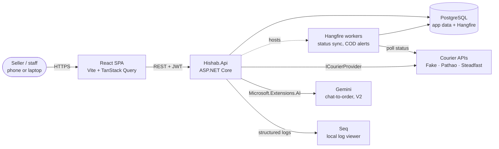
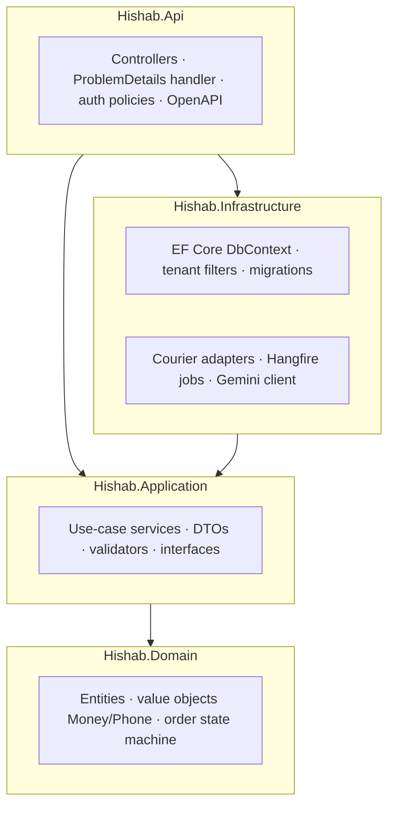
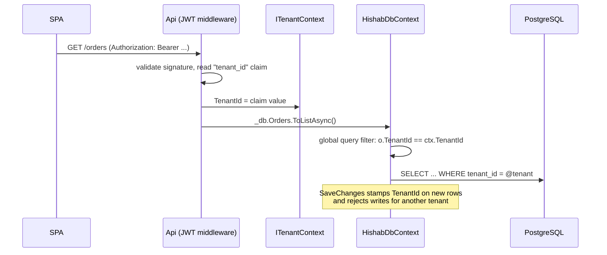
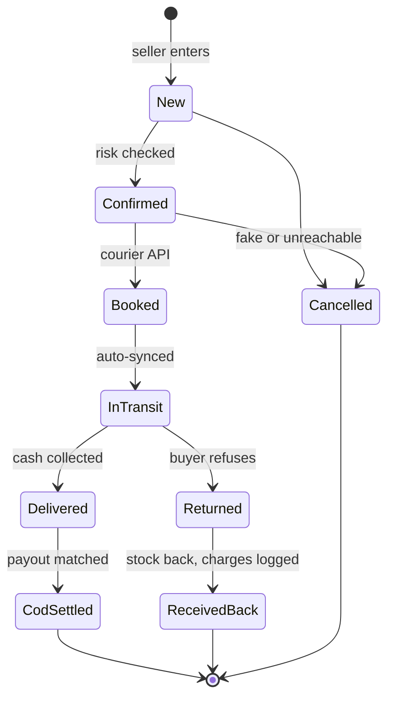

# Hishab architecture

Hishab is a **modular monolith**: one ASP.NET Core Web API (.NET 10 LTS) and one React
SPA, backed by PostgreSQL. Decisions behind this are in [`decisions/`](decisions/).

## 1. System context



- The SPA never talks to couriers or Gemini directly; the API owns every external call
  so keys stay on the server.
- Hangfire runs in the API process (one deployable) and stores jobs in the same
  PostgreSQL database.
- Courier calls use the seller's own API keys, through official APIs only.

## 2. Layers and modules



| Rule | Enforced by |
| --- | --- |
| Domain references nothing | `Hishab.ArchitectureTests` (NetArchTest) |
| Application references Domain only | `Hishab.ArchitectureTests` |
| Infrastructure implements Application interfaces | Dependency injection in `Hishab.Api` |

Each layer has a feature folder per module: **Shops, Orders, Customers, Couriers, Money,
Products, Reports**. A module only reaches into another one through its Application
services, never through its tables.

## 3. Tenant isolation

Every tenant-owned row has a `TenantId`. The tenant comes from the signed JWT, never
from the request body or URL.



Failure mode this protects against: a missing `WHERE` clause leaking Shop A's customers
to Shop B. Every new entity gets a cross-tenant integration test.

## 4. Order state machine



The transitions live in the Domain (`Order` aggregate), not in controllers. An invalid
transition throws a domain exception, which the global handler maps to a 409
ProblemDetails. Every transition appends an `OrderStatusHistory` row (who, when, from, to).

## 5. Repository layout

```text
src/api/      Hishab.sln: Domain, Application, Infrastructure, Api
src/web/      React + TypeScript + Vite SPA
tests/        UnitTests, IntegrationTests (Testcontainers), ArchitectureTests
docs/         PRD, this file, ADRs (decisions/), learning notes (learning/)
.github/      CI workflow, PR template
```
