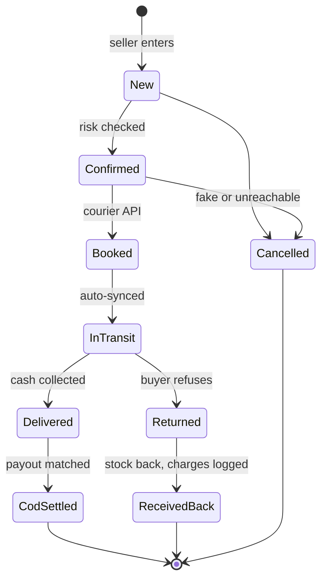

# Hishab: Product Requirements

As of 2026-11-19 · Syed Ahasan Habib

## Product summary

**Hishab is the back office for Facebook and Instagram sellers in Bangladesh: take an order in 20 seconds, book the courier in one click, and stop losing money on fake orders and unpaid cash on delivery (COD).**

**The problem.** Most small online sellers in Bangladesh sell through a Facebook page, Messenger and WhatsApp, not a website. A typical day looks like this:

- Orders arrive as comments and DMs. The seller copies name, phone, address and items into a notebook or Excel.
- Each parcel is booked by hand on a courier's merchant panel (Steadfast, Pathao, RedX), one at a time.
- Almost every order is COD, so the seller has no money until the courier pays out, and has no easy way to check which payouts are missing.
- Some buyers order and then refuse the parcel. The seller pays delivery and return charges for nothing, and the same buyer does it again next month.
- Nobody knows the real profit after product cost, delivery, returns and courier fees.

**The vision.** One screen where a seller sees every order from "customer messaged" to "money in my account", with the system warning them before they ship to a risky buyer.

**One-line pitch:** "Shopify-level order operations for sellers who will never build a website."

## Market and customers

The market is large but made of very small businesses. Pathao estimates about 200,000 merchants make up more than 80% of Bangladesh's digital commerce, and many are one- or two-person operations ([Future Startup, Sep 2026](https://futurestartup.com/2026/09/15/pathao-launches-pathao-commerce-strategic-coherence-and-pathaos-motivation/)). An older count put f-commerce pages at over 300,000 ([DHL, citing Dhaka Tribune 2023](https://www.dhl.com/discover/en-bd/e-commerce-advice/e-commerce-trends/guide-to-f-commerce-in-bangladesh)). Bangladesh had 60 million active social media users in January 2025 (same DHL source).

**Target segment for launch:** sellers shipping 10–30 parcels a day. Below that, a notebook still works; above it, the pain is severe and they will pay.

| Persona | Who they are | Daily reality | What they pay for |
| --- | --- | --- | --- |
| Nusrat, solo seller | Sells clothing from home, 5–15 orders a day | Takes orders in Messenger, books Steadfast by hand at night | Saving time, avoiding fake orders |
| Rafiq, growing shop owner | Gadget page, 2–4 staff, 30–100 orders a day | Staff make data-entry mistakes; nobody knows real profit | Team accounts, COD tracking, profit report |
| Mitu, packer / moderator | Staff member at Rafiq's shop | Enters orders, prints labels, answers "where is my parcel?" | (User, not buyer) a fast, simple screen |
| The buyer | End customer | Wants delivery updates | (Not a payer) a tracking link builds trust |

## Competitors and positioning

The space is real but not empty: Pathao launched a full commerce platform in September 2026, and cheap courier plugins already exist. Hishab must win on being courier-neutral and on profit clarity, not on order entry alone.

| Competitor | What it does | Price | Gap Hishab fills |
| --- | --- | --- | --- |
| [Pathao Commerce](https://futurestartup.com/2026/09/15/pathao-launches-pathao-commerce-strategic-coherence-and-pathaos-motivation/) | Storefront, unified Messenger / Instagram / WhatsApp chat, orders, inventory, delivery, instant payouts via Pathao Pay | Not published | Tied to one courier; sellers who use Steadfast or RedX, or several couriers, stay outside it |
| [SmartParcel BD](https://apps.shopify.com/smartparcel-bd) | Shopify app: one-click booking (Steadfast, Pathao, Carrybee), labels, return-history fraud check, COD reconciliation | Free, $1.99, $7.99 / month | Only for Shopify stores; most f-commerce sellers have no Shopify site |
| WordPress / Laravel courier plugins | Courier booking and phone fraud checks for WooCommerce sites | Free to low | Need a website and a developer |
| Couriers' own merchant panels | Booking and tracking for that courier only | Free | One courier per panel, no orders, customers or profit view |
| Excel / notebook | Everything, by hand | Free | Errors, no history, no warnings |

**Positioning statement:** *For Facebook-first sellers who ship 10+ parcels a day, Hishab is the courier-neutral order desk that shows real profit and warns you before you ship to a risky buyer. Unlike courier panels or Pathao Commerce, it works with every courier you use.*

**Moat over time:** a shared, consented risk network. Every return recorded by any Hishab seller improves the warning for all sellers.

## Business model and pricing

SaaS subscription by monthly order volume, with a free tier to win sellers away from notebooks. Prices are starting hypotheses to test with real sellers.

| Plan | Price (BDT / month) | Orders / month | Users | Includes |
| --- | --- | --- | --- | --- |
| Free | 0 | 100 | 1 | Orders, customers, 1 courier, basic risk warning |
| Starter | 299 | 1,000 | 2 | All couriers, bulk booking, labels, COD tracking |
| Growth | 799 | 5,000 | 5 | Profit reports, inventory, staff roles, SMS updates |
| Business | 1,999 | Unlimited | 15 | Multiple pages / brands, API access, priority support |

**Other revenue, later:** SMS credits in packs; referral fees from couriers; optional premium risk checks.

**Unit economics to watch:** cost per tenant (hosting, SMS) must stay well below the Starter price; churn is the biggest risk with tiny sellers.

## Features by module

**MVP** = needed for the first paying seller. **V2** = within 2–3 months after launch. **Later** = only once the core is used daily.

### 1. Shop setup and team

| Feature | Phase | Notes |
| --- | --- | --- |
| Sign up with phone number + OTP | MVP | Sellers rarely use email |
| Shop profile: name, logo, pickup address, default courier | MVP | One account = one tenant |
| Staff accounts with roles: Owner, Manager, Moderator, Packer | MVP | Moderator enters orders; only Owner sees profit |
| Multiple Facebook pages / brands under one account | Later | Business plan |
| Bangla and English interface | V2 | Bangla first for most sellers |

### 2. Orders

| Feature | Phase | Notes |
| --- | --- | --- |
| Quick order form: phone first, auto-fills returning customer | MVP | Target: an order in under 20 seconds |
| Paste a Messenger chat; extract name, phone, address and items | V2 | AI-assisted parsing, seller confirms every field |
| Order lifecycle with status history (see below) | MVP | Every change logged with who and when |
| Order sources: Facebook, Instagram, WhatsApp, phone, walk-in | MVP | For "which channel sells best" reports |
| Delivery charge rules: inside Dhaka / outside Dhaka | MVP | Configurable per shop |
| Advance payment / partial payment recorded | MVP | Common way to cut fake orders |
| Bulk actions: confirm, book, print | MVP | Packers work in batches |
| Exchanges and partial returns | V2 | |
| Order search and filters by status, date, courier, area | MVP | |

### 3. Customers and risk

| Feature | Phase | Notes |
| --- | --- | --- |
| Customer profile auto-created from phone number | MVP | Order history, total spent, returns |
| Risk badge on every order: Safe / Watch / Risky | MVP | From the shop's own history first |
| Shared risk network across Hishab sellers (opt-in, phone numbers hashed) | V2 | The moat; needs clear consent and privacy terms |
| Blocklist and notes per customer | MVP | |
| Rule: risky customers must pay delivery charge in advance | V2 | Automatic suggestion at order entry |

### 4. Courier booking and tracking

| Feature | Phase | Notes |
| --- | --- | --- |
| Connect courier accounts with the seller's own API keys | MVP | Steadfast and Pathao first, RedX next |
| One-click and bulk booking; save consignment ID and tracking code | MVP | |
| Automatic status sync (webhook or scheduled polling) | MVP | |
| Courier recommendation per order by area and success rate | Later | |
| Shipping label and invoice printing (A4 and thermal) | MVP | |
| Customer tracking link sent by SMS | V2 | |

### 5. COD and money

| Feature | Phase | Notes |
| --- | --- | --- |
| COD expected vs collected per courier | MVP | The core "who owes me money" view |
| Record courier payouts and match them to parcels | MVP | Manual first, import from courier later |
| Return and delivery charge tracking | MVP | |
| Online payment links (bKash / Nagad) for advance payment | Later | Needs merchant accounts |

### 6. Products and stock

| Feature | Phase | Notes |
| --- | --- | --- |
| Product catalog with variants (size, colour) and cost price | MVP | Cost price is needed for profit |
| Stock reduced on confirm, restored on return | V2 | |
| Low-stock alert | V2 | |

### 7. Reports and dashboard

| Feature | Phase | Notes |
| --- | --- | --- |
| Today: new orders, to book, in transit, delivered, returned | MVP | Home screen |
| Real profit per day / month: sales − product cost − delivery − returns − COD fees | MVP | The headline feature for owners |
| Return rate by area, courier and source | V2 | |
| Top products and top customers | V2 | |
| Staff performance (orders entered, errors) | Later | |

### 8. Notifications

| Feature | Phase | Notes |
| --- | --- | --- |
| SMS order confirmation to the buyer | V2 | Reduces refusals; uses SMS credits |
| In-app alerts: COD overdue, parcel stuck for 5+ days | V2 | |
| Daily summary to the owner | Later | |

### 9. Platform and admin

| Feature | Phase | Notes |
| --- | --- | --- |
| Plan limits and usage meter | MVP | Free tier capped at 100 orders |
| Subscription billing | V2 | Manual bKash payment at first |
| Super-admin console: tenants, usage, support | V2 | |
| Audit log | MVP | |
| Data export (CSV) | MVP | Sellers trust a tool they can leave |

## Order lifecycle

Every order moves through these states and the history is logged. Cancellations and returns are where sellers lose money today, so the risk check sits before booking and returns feed the customer's risk badge.

## Integrations

Each seller connects with their own courier credentials; Hishab never resells courier service. Every courier sits behind one internal `ICourierProvider` interface, so adding a courier means adding one adapter.

| Integration | Purpose | What's known | Phase |
| --- | --- | --- | --- |
| Pathao Courier merchant API | Booking, price check, cities / zones, tracking | Sandbox at courier-api-sandbox.pathao.com, OAuth with client ID, secret and merchant login ([SDK docs](https://mojnomiya.github.io/pathao-python/authentication)) | MVP |
| Steadfast Courier API | Booking, bulk booking (up to 500 per request), status | API key + secret key per merchant ([community SDK docs](https://steadfast-python.readthedocs.io/en/latest/order_management.html)); confirm against Steadfast's official docs | MVP |
| RedX | Booking and tracking | API access to confirm | V2 |
| SMS gateway (local provider) | Order confirmation, tracking links | Pay per SMS; resold as credits | V2 |
| bKash / Nagad | Advance payment links, subscription fees | Merchant onboarding needed; sandbox for the demo | Later |
| Meta (Messenger / Instagram) | Read messages, create orders from chat | Needs Meta app review | Later |
| AI (Gemini free tier) | Turn a pasted chat into a draft order | Seller confirms every field | V2 |

**Fraud data, a deliberate choice:** some open-source checkers log in to courier merchant panels with stored passwords to read return counts ([example](https://pypi.org/project/courier-fraud-checker-bd/0.1.1/)). Hishab will not scrape panels. Risk comes from the shop's own delivery history, then the opt-in shared network, plus any official courier endpoint that exists.

## Roadmap

| Phase | Goal | Scope | Exit criteria |
| --- | --- | --- | --- |
| 0. Discovery (1 week) | Confirm the pain | Interview 5–10 sellers; collect real order and return examples | 3+ sellers say they would try it |
| 1. MVP (6–8 weeks) | One seller runs a full day on Hishab | Modules 1–7 MVP rows; Steadfast + Pathao sandbox | 1 seller uses it for 2 weeks without Excel |
| 2. V2 (2–3 months) | Sellers stay and pay | Bangla UI, SMS, shared risk network, AI chat-to-order, stock, return analytics | 20 active shops, 5 paying |
| 3. Later | Scale | Payment links, Meta integration, multi-brand, courier recommendation, public API | Positive unit economics |

For the GitHub showcase, Phase 1 plus two V2 items (AI chat-to-order and Bangla UI) make a complete, demoable product.

## Success metrics

| Metric | Why it matters | Early target |
| --- | --- | --- |
| Time to enter an order | Core promise | Under 20 seconds |
| Weekly active shops | Real usage, not sign-ups | 20 by end of V2 |
| Orders processed per shop per week | Depth of use | 50+ |
| Return rate of shops after 2 months vs before | Proves the risk feature works | Visible drop, measured per shop |
| Free → paid conversion | Business viability | 10–20% |
| Monthly churn of paying shops | Small sellers churn fast | Below 5% |

## Risks and open questions

| Risk | Impact | Mitigation |
| --- | --- | --- |
| Pathao Commerce bundles the same features for free | Sellers who use only Pathao won't switch | Target multi-courier and Steadfast sellers; win on profit view and speed |
| Very low willingness to pay | No revenue | Generous free tier, low prices, earn from SMS credits |
| Courier APIs change or restrict access | Booking breaks | One adapter per courier, contract tests, status page |
| Privacy of the shared risk network | Legal and trust risk | Opt-in, hashed phone numbers, show counts not identities, clear terms |
| Sellers stay on Excel out of habit | Low adoption | Import from Excel, 20-second order entry, Bangla UI |

**Open questions for discovery:**

- [ ] Which couriers do sellers use, and how many at once?
- [ ] What return rate do they see, and what does one return cost them?
- [ ] Who enters orders: the owner or staff?
- [ ] Would they pay 299 BDT a month, and how (bKash)?
- [ ] Phone or laptop: where do they work? (decides mobile-first design)

## Sources

- [Pathao launches Pathao Commerce — Future Startup, 15 Sep 2026](https://futurestartup.com/2026/09/15/pathao-launches-pathao-commerce-strategic-coherence-and-pathaos-motivation/)
- [Guide to f-commerce in Bangladesh — DHL, May 2025](https://www.dhl.com/discover/en-bd/e-commerce-advice/e-commerce-trends/guide-to-f-commerce-in-bangladesh)
- [SmartParcel: Courier BD & COD — Shopify App Store](https://apps.shopify.com/smartparcel-bd)
- [Pathao Python SDK, authentication](https://mojnomiya.github.io/pathao-python/authentication)
- [Steadfast Python SDK, order management](https://steadfast-python.readthedocs.io/en/latest/order_management.html)
- [courier-fraud-checker-bd — PyPI](https://pypi.org/project/courier-fraud-checker-bd/0.1.1/)
