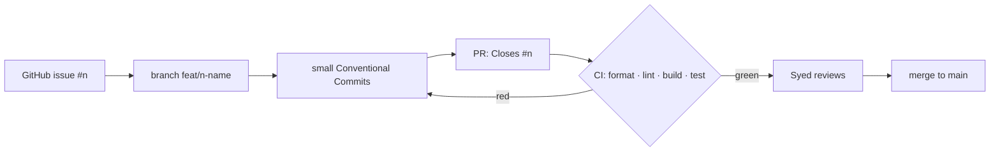

# 00: How we work

## The idea in plain words

Think of a restaurant kitchen. Orders (issues) come in on tickets. Each cook works one
ticket on their own station (a branch). Before a plate leaves, the head chef checks it
(pull request review) and a checklist runs automatically (CI: format, build, tests).
Big menu changes are written down with the reason (ADRs), so nobody argues about them
again six months later.

## The pieces

- **Git flow:** `main` is always releasable. One branch per issue (`feat/12-quick-order`),
  never a direct commit to `main`, never a force-push.
- **Conventional Commits:** `feat(orders): add quick order form`. The type and scope make
  history searchable and can drive changelogs later.
- **CI:** GitHub Actions runs the api and web jobs on every PR. A red build blocks merge.
- **ADRs:** short Markdown files in `docs/decisions/`, with context, the decision, the
  alternatives and the consequences.
- **Clean Architecture:** Domain (rules) <- Application (use cases) <- Infrastructure
  (EF Core, couriers) and Api (HTTP). Dependencies point inwards; architecture tests
  fail the build if they don't.
- **Monorepo:** `src/api`, `src/web`, `tests`, `docs` live in one repo, so one PR can
  change the API, the generated client and the UI together.

## Interview questions

1. **Why ADRs instead of a wiki?** They live next to the code, are reviewed in PRs, and
   record *why* plus the rejected alternatives, which is what new team members lack.
2. **Why a modular monolith rather than microservices?** One team, small load, and
   transactional data: a monolith gives simple deploys and ACID transactions, while
   module boundaries keep a later split possible.
3. **What do architecture tests protect against?** Gradual erosion: a quick
   `using Infrastructure` in the Domain compiles fine but breaks testability. The test
   turns that into a failed build instead of a code-review argument.
