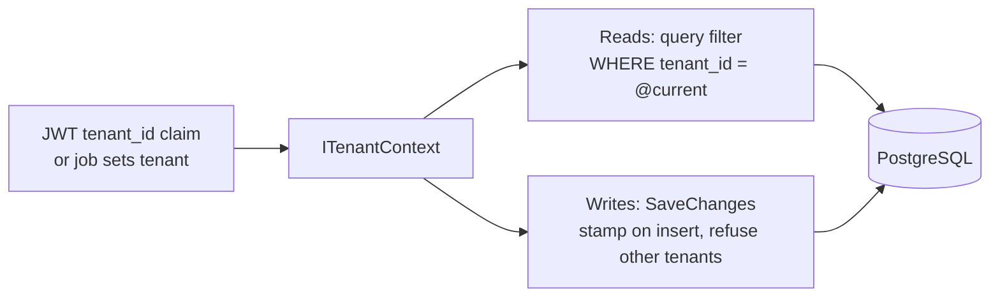

# 01: Tenant isolation with EF Core global query filters

## The idea in plain words

All shops share one database, like flats sharing one mailroom. Instead of trusting every
resident (every query a developer writes) to take only their own letters, the mailroom
clerk checks your key card and only ever hands you mail with your flat number.
In Hishab the key card is `ITenantContext`, the clerk is `HishabDbContext`.

## How it works here

- **One convention, no per-entity code.** `OnModelCreating` finds every entity
  implementing `ITenantOwned` and adds a *named* filter `"Tenant"` plus an index on
  `TenantId`. Forgetting the filter on a new entity is impossible.
- **Fail closed.** No tenant set means the filter compares with `NULL` and matches
  nothing; saving a tenant-owned row without a tenant throws.
- **Two layers.** Reads are guarded by the filter, writes by `SaveChanges` (stamp on
  insert, refuse rows of another tenant, refuse moving a row). The mutation check in
  issue #3 showed that removing the filter fails only the read tests, while the write
  layer still holds.
- **Named filters (EF Core 10)** let a future soft-delete filter be switched off with
  `IgnoreQueryFilters(["SoftDelete"])` while the tenant filter stays on.
- **Tests at three speeds:** unit (`TenantContext` cannot switch tenants), architecture
  (every tenant-owned type is mapped and filtered, no database), integration
  (`CrossTenantAssert` against real PostgreSQL).

## Escape hatches to watch in review

`IgnoreQueryFilters()`, `FromSql`/`ExecuteSql` raw SQL, `ExecuteUpdate`/`ExecuteDelete`
(they skip `SaveChanges`), Dapper, and Hangfire jobs that forget to set the tenant.
PostgreSQL row-level security (ADR 0002) would be a database-enforced second net.

## Interview questions

1. **How do you guarantee one tenant cannot read another's data?** A global query filter
   applied by convention to every tenant-owned entity, the tenant taken only from the
   signed token, fail-closed defaults, write checks in `SaveChanges`, and a
   cross-tenant test per entity. Optionally RLS in the database as defence in depth.
2. **What bypasses an EF Core global query filter?** `IgnoreQueryFilters`, raw SQL,
   other data access libraries, and bulk `ExecuteUpdate/ExecuteDelete` for writes.
   Keep them in Infrastructure, review them, and add RLS if the risk justifies it.
3. **Why run migrations at startup only in Development?** Several instances starting
   together race to migrate, a failed migration leaves the app half-up, and the app
   account would need DDL rights. In production, migrate as an explicit deployment step
   (migration bundle or SQL script) with its own rollback plan.
