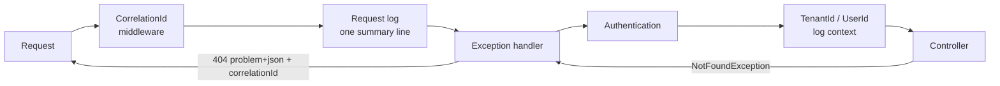

# 02: Structured logs, correlation IDs and ProblemDetails

## The idea in plain words

A courier gives every parcel one tracking number. Each hub scans it, and when a parcel
goes missing you search for one number instead of reading every hub's notebook.

- The **correlation ID** is the tracking number of a request (`X-Correlation-ID`).
- **Structured logs** are the scans: named fields (`CorrelationId`, `TenantId`,
  `StatusCode`) you can filter on in Seq, not sentences you grep.
- **ProblemDetails** (RFC 7807) is the standard "delivery failed" slip: every error has
  the same shape (`type`, `title`, `status`, `detail`, `errors`, `correlationId`), so
  the SPA handles errors in one place and a seller can quote the ID to support.

## Decisions in issue #4

- **Domain exceptions map to statuses in one handler**: NotFound 404, Conflict 409,
  Validation 400 with `errors`. Anything else is a 500 with no internal details; the
  stack trace goes to the logs only.
- **Untrusted correlation IDs are validated** (64 safe characters max), so a caller
  cannot inject fake log lines.
- **Personal data:** log IDs, never names or phones. `PhoneMasker` for deliberate use,
  plus a Serilog enricher that masks any BD mobile number reaching a log property.
- **No global logger.** `preserveStaticLogger: true` keeps each host's logger private;
  request logging gets the host logger explicitly. Found by a failing test: the request
  summary went to another test host's logger, then (after the first fix) nowhere.

## Interview questions

1. **How do you trace one user's failed request across logs?** Give every request a
   correlation ID at the edge, propagate it (header, log context, outgoing calls, job
   arguments), return it in error responses, and search for it in a central log store.
2. **How do you keep personal data out of logs?** Log identifiers, not content; mask at
   the call site; add a redaction step in the logging pipeline as a safety net; keep
   exception messages free of personal data; restrict and expire log access.
3. **Why ProblemDetails instead of custom error JSON?** It is a standard (RFC 7807 /
   9457) that clients, gateways and tools understand; one shape for every error means
   one client-side handler and per-field validation errors for free.
