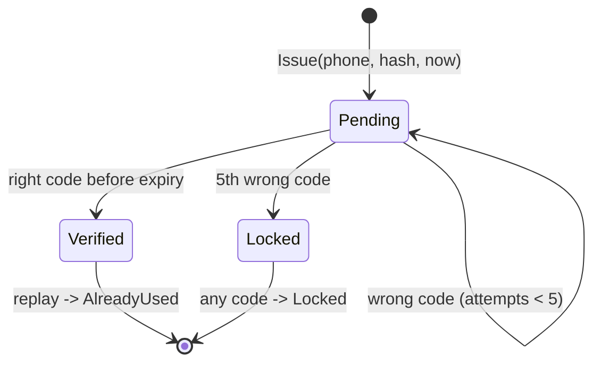

# 03: Value objects and OTP security

## The idea in plain words

**Value object.** A banknote is defined by its value, not its serial number: two 500 taka
notes are interchangeable. `Phone` is the same: "01712-345678" and "+880 1712 345678"
are one number, so `Phone` normalises both to `+8801712345678` and compares by value.
Validation happens once, in `Phone.Parse`; any code holding a `Phone` knows it is valid.

**OTP.** A bank locker key sent by courier. The bank keeps only a *fingerprint* of the
key, the key works for 5 minutes, and five wrong tries jam the lock.

## Decisions in #5 (part A)

- **Keyed hash (HMAC + server secret), bound to the phone.** Only 1,000,000 codes exist,
  so a plain SHA-256 is reversed in milliseconds from a leaked table. With a secret key
  the attacker needs the database *and* the key. Binding the phone stops a hash from
  one challenge matching another phone.
- **Constant-time comparison** (`CryptographicOperations.FixedTimeEquals`), so response
  time does not leak how much of the value matched.
- **Results, not exceptions.** `Verify` returns `Invalid/Expired/Locked/AlreadyUsed`;
  the API (part B) returns the same answer for all of them, so an attacker learns
  nothing about which phones exist or how close they are.
- **Time is a parameter** (`now`), so expiry is tested at exact boundaries without
  sleeping. A mutation check (`>=` to `>`) failed the 5-minute boundary test as expected.
- **Masked `ToString()`** on `Phone`, so string interpolation in a log cannot leak it.
- **Cryptographic RNG** for codes; `System.Random` is predictable.

## Interview questions

1. **Why hash a 6-digit OTP, and why is a plain hash not enough?** Stored codes are
   live credentials for 5 minutes. A plain hash of a million values is brute-forced
   instantly; an HMAC with a server secret (kept outside the database) is not.
2. **How do you stop OTP brute force?** Attempt limit per challenge with lockout, short
   expiry, single use, rate limits per phone and per IP on both sending and verifying,
   and identical responses for every failure.
3. **What makes something a value object rather than an entity?** No identity of its
   own, equality by value, immutable, and self-validating, so invalid states (an
   unparsed phone) cannot exist past the boundary.
