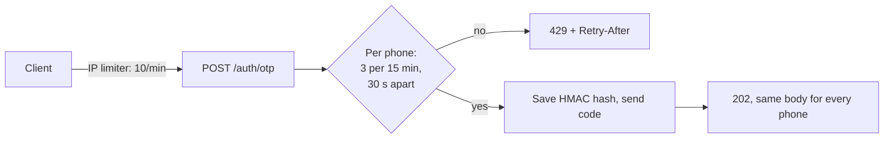

# 04: Rate limiting, SMS pumping and account enumeration

## The idea in plain words

A bank's OTP hotline needs three rules:

1. **Per caller line (IP):** one line cannot dial 1,000 times a minute.
2. **Per customer (phone):** at most 3 codes per 15 minutes, 30 seconds apart. Otherwise
   attackers make us send paid SMS to random numbers (**SMS pumping**), or request a
   fresh code every time the 5-try lock closes and keep guessing.
3. **One answer for everyone:** "a code is on its way" whether the number is a customer
   or not, so nobody can find out who our customers are (**account enumeration**).

## How the limits combine

5 wrong tries per code x 3 codes per 15 minutes = at most **15 guesses per 15 minutes**
per phone. Against a million codes, a full day of trying succeeds about 1 time in 700.
Without the per-phone send limit, an attacker could request a new code after every
lockout and guess without end.

## Decisions in #5 (part B)

- **Two layers, two stores.** The IP limit is ASP.NET Core's in-memory rate limiter
  (cheap; per instance). The per-phone limit is counted in PostgreSQL, so it holds
  across restarts and instances, and it costs money to get wrong.
- **Uniform failures.** Wrong, expired, locked, already used, or no code at all: always
  the same 400 for the `code` field. The send response is identical for known and
  unknown phones (tested by comparing the raw bodies).
- **One transaction for sign-up.** Shop and Owner are saved by one `SaveChanges`, so a
  shop never exists without its owner. A row version (PostgreSQL `xmin`) on the
  challenge stops a double-tapped Verify from creating two shops.
- **Startup validation.** No OTP key or no delivery mode means the app refuses to start,
  instead of failing on the first sign-up (or logging codes in production).
- **Known gap:** behind a reverse proxy the IP limiter needs `ForwardedHeaders`, or all
  users share the proxy's IP. Noted for deployment.

## Interview questions

1. **How do you stop SMS pumping?** Per-phone and per-IP send limits, short code
   lifetimes, cost alerts, and (later) CAPTCHA or country allow-lists; never let one
   anonymous endpoint trigger unlimited paid messages.
2. **What is account enumeration and how do you prevent it?** Learning whether an
   account exists from different responses, errors or timings. Give identical responses
   (same status, body and roughly the same work) for existing and unknown accounts.
3. **Fixed window, sliding window or token bucket?** Fixed window is simplest but allows
   a burst at the window edge; sliding window smooths that; token bucket allows
   controlled bursts with a steady refill. For OTP sends, a simple fixed window per IP
   plus a durable per-phone counter is enough.
