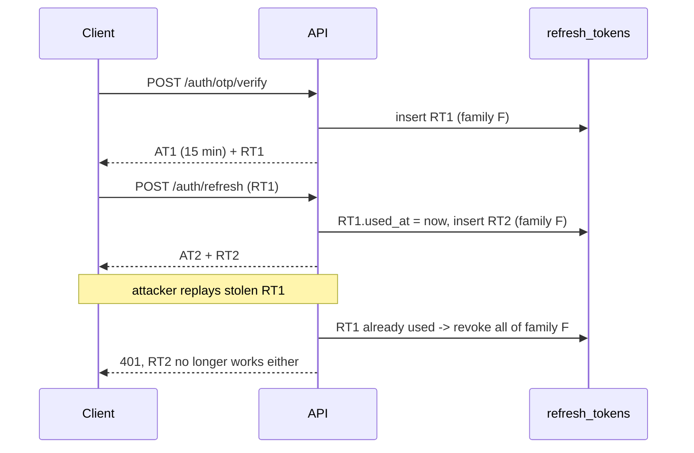

# 05: JWT access tokens and refresh token rotation

## The idea in plain words

A hotel gives you a **key card** (access token) that opens doors on its own: no door calls
the front desk. That makes it fast, but a card cannot be taken back, so it expires after
**15 minutes**. To get a new card you show a **voucher** (refresh token) at the front desk
(the database). Each voucher works **once** and is swapped for a new card plus a new
voucher. If anyone shows a voucher that was already used, someone has a copy: the desk
cannot tell the guest from the thief, so it **cancels every voucher in that chain** and
both must check in again.

## Why we built it this way

- **Stateless access, stateful refresh.** Every request checks the JWT signature in memory
  (no database hit); only refresh and logout touch the database. Revocation is therefore
  "at most 15 minutes late", which is the deliberate trade-off.
- **`tenant_id` comes only from the signed token.** `TenantResolutionMiddleware` copies it
  into `ITenantContext`, and the EF Core tenant filter does the rest.
- **Hashed refresh tokens.** The table stores SHA-256 of a 256-bit random value. A leaked
  backup cannot be replayed. A plain hash is enough because the input cannot be guessed (OTP
  codes needed an HMAC because a 6-digit code can be).
- **Row version on redeem.** Two parallel refreshes with the same token: one wins, the other
  gets 401 instead of forking the family into two valid chains.
- **Cookie by default, body on request.** Browsers get the refresh token in an `HttpOnly`,
  `Secure`, `SameSite=Strict`, `Path=/auth` cookie: scripts (XSS) cannot read it, other sites
  cannot send it (CSRF), and it never travels with ordinary API calls. Mobile or server
  clients ask for `tokenDelivery: "Body"`. Never both: a token in the body is readable by JS.
- **HS256 with a 32-byte key from user-secrets**, `ValidAlgorithms` pinned so `alg: none` or
  algorithm confusion cannot slip through. RS256 pays off only when other services must verify
  tokens without being able to mint them.
- **Validation uses `TimeProvider`**, the same clock as issuing, so tests expire tokens by
  moving a fake clock instead of sleeping.

## Interview questions

1. **How do you revoke a JWT?** You mostly cannot: it is valid until `exp`. Keep it short
   (15 min) and revoke the *refresh* token, which is checked in the database. For instant
   revocation, add a deny-list of `jti` values or a per-user "tokens valid after" timestamp,
   at the cost of a lookup per request.
2. **What happens if a refresh token is stolen?** The thief and the user both hold it. The
   first one to use it gets a new pair; when the other uses it, it is already redeemed, so we
   detect reuse and revoke the whole family. Both are logged out; the attacker's window is
   one access token lifetime.
3. **Where should a SPA keep tokens?** Access token in memory only; refresh token in an
   `HttpOnly`, `SameSite=Strict` cookie scoped to the auth path. `localStorage` is readable
   by any injected script, so one XSS bug would leak a 30-day session.
