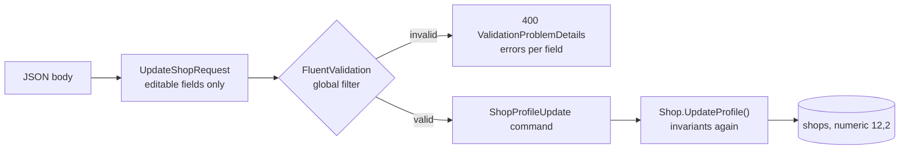

# 06: Request DTOs, FluentValidation and Money

## The idea in plain words

At a bank you never hand the clerk your ledger and say "update whatever I wrote". You fill
in a **change form** that has only the fields you may change. The clerk **checks the form**
(missing name? negative amount?), and only then does the bank apply it to your account,
which has its own rules it never breaks.

## Why we built it this way

- **DTO, never the entity.** Binding `Shop` would let a client post `id`, `createdAt` or,
  on other entities, `tenantId` or `role` (**over-posting / mass assignment**). The DTO
  simply has no such properties; a test posts them and proves they are ignored.
- **Two layers of checks, two jobs.** FluentValidation gives friendly per-field messages
  for the form. `Shop.UpdateProfile` checks the invariants again so the entity is valid
  whoever calls it (a job, an import, a future endpoint).
- **A global action filter runs the validators**, so no endpoint can forget them. It reuses
  MVC's `ValidationProblem`, so its 400s look exactly like model-binding 400s, with
  `correlationId`. (`FluentValidation.AspNetCore` auto-validation is deprecated.)
- **Money is `decimal` in a `Money` value object.** `0.1 + 0.2 != 0.3` in `double`, and
  those drifts add up across thousands of COD parcels. Amounts with more than 2 decimals are
  **rejected, not rounded**: a silently rounded amount is a wrong amount. Every `Money`
  column is `numeric(12,2)` through one EF Core convention.
- **The shop has no id in the URL** (`GET /shop`), and a tenant filter on `Shop` itself
  (`Id == current tenant`) means no query can read another shop by accident.
- **Policies, not role lists.** `[Authorize(Policy = "ManageShop")]` names a capability;
  which roles have it lives in one place (#8 builds the full matrix).

## Interview questions

1. **Why never bind entities directly to requests?** Over-posting: any property the entity
   has becomes writable by the client, including keys, ownership and flags. DTOs also
   decouple the public contract from the database model, so either can change alone.
2. **Why `decimal` and not `double` for money?** `double` is binary floating point and
   cannot represent most decimal fractions exactly, so sums drift. `decimal` is base-10 with
   28-29 significant digits: exact for currency. In the database, use `numeric`, not `float`.
3. **Where should validation live?** Input shape at the edge (DTO validators: required,
   lengths, formats, with per-field messages); business invariants in the domain (the entity
   refuses invalid state). The edge is for user experience, the domain for correctness.
