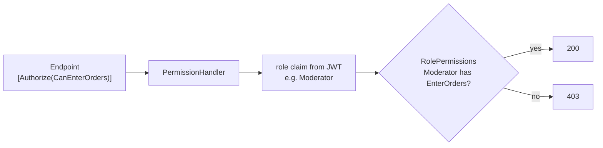

# 07: Policy-based authorization, permissions and least privilege

## The idea in plain words

An office building. **Role-based** checks put a list on every door: "Managers and Owners
may enter". Add a room or change a role, and you walk around rewriting door lists.
**Permission-based** checks put one need on each door ("needs: Enter orders") and keep a
single **rule book** that says which role has which permission. Doors never mention roles.
**Least privilege**: each role gets only what its job needs; the Packer's card does not open
the accounts room.

| Role | ManageShop | ManageStaff | EnterOrders | Pack | SeeProfit |
| --- | --- | --- | --- | --- | --- |
| Owner | yes | yes | yes | yes | yes |
| Manager | yes | | yes | yes | |
| Moderator | | | yes | | |
| Packer | | | | yes | |

## Why we built it this way

- **One policy per permission, generated from the enum.** A new permission cannot exist
  without its policy, and endpoints read as capabilities (`CanSeeProfit`).
- **The token carries the role, not the permissions.** The handler maps role to permissions
  on each request, so a matrix change applies at once and tokens stay small. A changed or
  removed user is picked up at the next refresh (at most 15 minutes).
- **Invite = pre-created user.** The owner adds a phone with a role; the person's next OTP
  login finds that user and joins the shop. No separate invitations table, and the "phone
  belongs to one shop" rule (ADR 0006) is checked across tenants on purpose.
- **Removal is a hard delete.** With unique phones, a soft-deleted user would lock that
  phone out of Hishab forever. Their refresh tokens cascade away with them.
- **Another shop's member is 404, not 403.** The tenant filter hides the row, so the API
  gives no hint that the id exists.
- **The test matrix is written out by hand**, not computed from `RolePermissions`, so any
  change to who-can-do-what is a visible diff in review.

## Interview questions

1. **Role-based vs policy-based authorization?** Role checks hard-code role names at every
   endpoint. Policies name a requirement; handlers decide how it is met (roles, claims,
   resource ownership), so the rule changes in one place.
2. **How would you model permissions if roles become customisable per shop?** Move the
   matrix into tables: `roles(shop_id, name)` and `role_permissions(role_id, permission)`.
   Endpoints and policies stay the same; the handler reads the shop's matrix (cached, and
   invalidated on change) instead of the static map.
3. **A removed employee still has a valid JWT. What now?** Short access tokens bound the
   window (15 min here) and refresh fails at once. For instant cut-off, check a per-user
   security stamp or a deny-list on each request, at the cost of a lookup.
