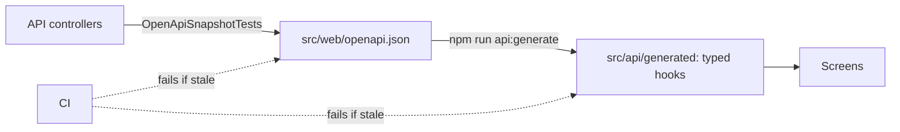

# 09: Generated API clients and token storage in a SPA

## The idea in plain words

**Generated client.** Ordering spare parts by the manufacturer's part numbers instead of
describing the part on the phone. The API publishes a catalogue (OpenAPI); orval turns it
into typed functions and TanStack Query hooks. Rename a field on the server and the web app
stops *compiling*, instead of breaking in a seller's hands.

**Token storage.** A hotel key card you keep in your pocket (memory) is safer than one taped
to the door (localStorage), where anyone passing (an injected script) can copy it. When you
lose it (a page reload), the front desk re-issues it against your booking voucher, which
the hotel keeps in a locked drawer you cannot open yourself (an HttpOnly cookie).

## Why we built it this way

- **Drift is caught twice, without running servers in CI.** A .NET test compares the live
  OpenAPI document with the committed snapshot; the web job regenerates the client and fails
  on any diff. The generator also exposed real drift on day one: enums documented as numbers
  (the OpenAPI generator reads the HTTP JSON options, not MVC's), money as `number | string`,
  and required fields marked optional. All three were fixed in the API.
- **Access token in memory, refresh token in an HttpOnly cookie.** XSS cannot read either;
  CSRF cannot use the cookie (`SameSite=Strict`, `Path=/api/auth`). Reloading costs one
  `/api/auth/refresh` call.
- **Same origin via `/api`.** All controllers live under `/api`, so one proxy rule (Vite in
  development, the reverse proxy in production) makes the cookie work.
- **Single-flight refresh.** Parallel 401s share one refresh call. A second refresh with the
  same token would look like theft to the API (#6) and sign the user out.
- **Session as a query, not an effect.** `sessionQuery` restores the session from the cookie;
  login seeds it, logout clears it, an unrecoverable 401 sets it to null, and every protected
  screen reacts to that one value.
- **TanStack Query caching.** Hooks share cached data by key, dedupe requests, and do not
  retry 4xx errors (they cannot succeed).

## Interview questions

1. **Where do you store tokens in a SPA and why?** Access token in memory (short-lived, gone
   on reload, unreachable for other scripts); refresh token in an HttpOnly, Secure,
   SameSite cookie scoped to the auth path. localStorage is readable by any script, so one
   XSS bug leaks a long-lived session. The cookie needs CSRF thinking: SameSite and a narrow
   path cover it here.
2. **How do generated clients prevent frontend/backend drift?** Types come from the contract,
   so a breaking change is a compile error. It only works if the contract is accurate and
   current: snapshot the OpenAPI document, test it against the running API, and fail CI when
   the committed client is stale.
3. **Why serialise token refresh?** With one-time refresh tokens, two concurrent refreshes
   present the same token twice; the server must treat the second as reuse. Sharing one
   in-flight promise makes the client behave like a single caller.
