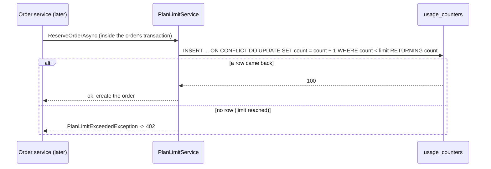

# 10: Plan limits, metering and calendar months in a time zone

## The idea in plain words

A mobile data pack. The **plan** is the entitlement ("5 GB a month"); the operator's
**meter** counts what you used. The check happens at the operator, not in your phone app,
so nobody can skip it. And "a month" is the operator's calendar month: Hishab's months are
Dhaka months (UTC+6), so November ends at **18:00 UTC on 30 November**.

## Why we built it this way

- **Entitlements in one catalogue** (`Plans.LimitsFor`), copied from the PRD; the shop only
  stores its plan (Free by default, audited when it changes).
- **Check and count in one statement.** "Check, then insert" lets two requests at 99/100 both
  pass. The upsert takes a row lock on the counter, so the second request re-checks after
  the first commits, matches no row, and gets 402. A test fires 10 reserves at 5 free slots:
  exactly 5 succeed.
- **A counter, not `COUNT(*)` of orders.** Usage only goes up: cancelling or deleting an order
  does not give quota back, and the meter exists before the orders table does.
- **Users are counted, with a lock.** Staff can be removed, so the user limit counts real
  rows, after `SELECT ... FOR UPDATE` on the shop row inside the invite's transaction:
  concurrent invites take turns (8 parallel invites on a 5-user plan: 4 created).
- **402 Payment Required** says "upgrade", which the web app can turn into an upgrade prompt;
  409 would say "conflict with state" and 403 "you may not".
- **One time zone rule, in one type.** `BillingPeriod.Containing(instant)` turns a UTC instant
  into the Dhaka month and its exact UTC bounds. Store UTC, compute business calendars in the
  business's zone. If the OS lacks the zone database (slim containers), a fixed UTC+6 zone is
  exact because Bangladesh has no daylight saving.

## Interview questions

1. **Where should plan limits be enforced so they can't be bypassed?** On the server, in the
   one service every write that consumes quota goes through, inside the same transaction as
   the write. The UI may show limits, but only the server's check counts.
2. **How do you handle month boundaries across time zones?** Store instants in UTC. Define the
   period in the business's zone (Dhaka midnight on the 1st), convert those bounds to UTC
   instants, and test the edges (17:59:59 vs 18:00 UTC, year end, leap February).
3. **How do you stop two requests from both using the last unit of quota?** Make check and
   increment atomic: a conditional upsert (`... WHERE count < limit RETURNING`), a row lock
   (`SELECT ... FOR UPDATE`), or a unique/serializable constraint, never read-then-write.
