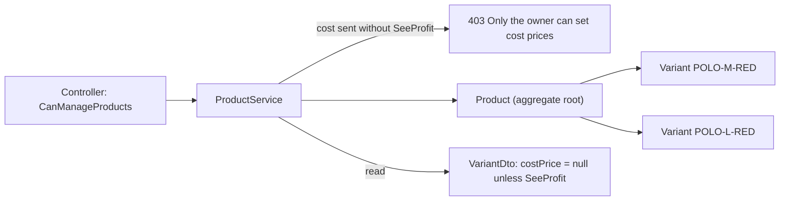

# 11: Aggregates, soft delete and field-level authorization

## The idea in plain words

A shirt display in a shop. The **aggregate** is the display as a whole (Polo shirt + its
sizes and colours). You change it only through the display's own rules: every variant has
its own SKU, no negative prices, always at least one variant on show. **Soft delete** takes a
shirt off the shelf but keeps it in the stock book, so last month's receipts still make
sense. **Field-level authorization**: everyone may look at the display, but the cost-price
tag lives in the owner's ledger, not on the shelf.

## Why we built it this way

- **The product is the aggregate root.** Variants have no public setters; `AddVariant`,
  `UpdateVariant` and `RemoveVariant` live on `Product`, which can see every sibling and so
  enforce cross-variant rules. A simple product is just one variant without options, so
  orders always point at a variant.
- **Soft delete by convention.** `ISoftDeletable` gets a named `SoftDelete` query filter, like
  the tenant filter. Deleting a product also deletes its variants, which frees their SKUs:
  a partial unique index (`(tenant_id, sku) WHERE deleted_at IS NULL`) allows reuse and still
  stops two active variants sharing a SKU, even under concurrent requests.
- **Field-level authorization in the service, not the controller.** `IRequestContext.Has`
  tells the service whether the caller holds `SeeProfit`. Reads blank the cost; writes that
  send a cost without it are rejected (403), and omitting the cost keeps the current one, so a
  Manager can edit prices without wiping the owner's costs.
- **Search** uses `ILIKE` on name or SKU with `%` and `_` escaped (so "50%" means "50%").
  At larger catalogues a `pg_trgm` index would make `%term%` searches fast.

## Changing a price without changing past orders

Orders (next issues) will copy the product name, SKU and price into each order line when the
order is placed (a snapshot). Editing the catalogue changes future orders only, and soft
delete means the line's variant reference never dangles.

## Interview questions

1. **How do you change a product's price without changing past orders' totals?** Snapshot the
   price (and name/SKU) into the order line at order time; never compute order totals from the
   live catalogue. Keep the referenced rows (soft delete) for traceability.
2. **Soft delete vs hard delete?** Soft delete keeps history and references valid and allows
   undo, at the cost of filtering everywhere (a global filter), uniqueness only among active
   rows (partial indexes), and growing tables. Hard delete suits data with no history value or
   a legal duty to erase (personal data), as with removed staff users here.
3. **Where do you enforce field-level authorization?** Where the data is shaped and changed:
   the service that builds the response and applies the write, using the caller's
   permissions. Hiding a field in the UI alone leaks it through the API.
