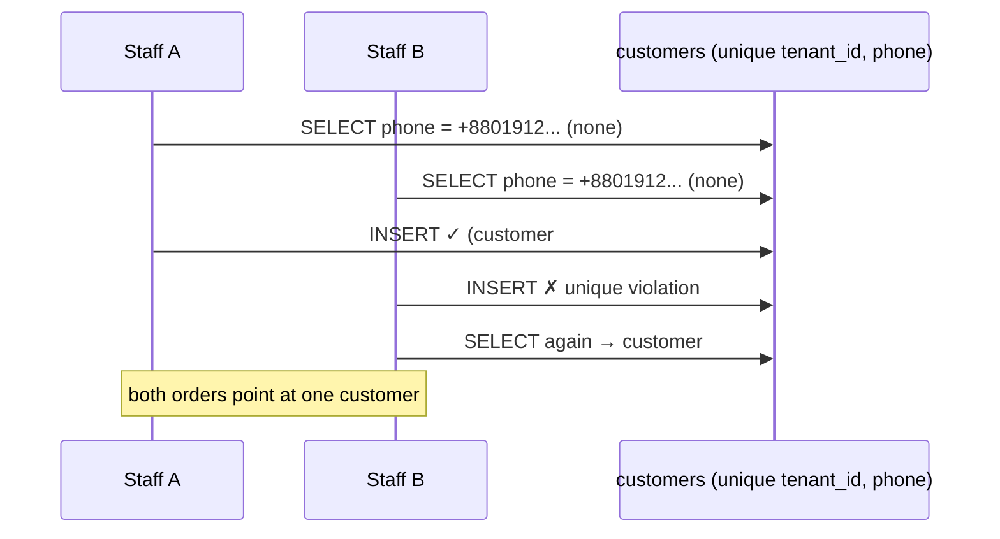

# 12: Natural keys, surrogate keys and race-safe find-or-create

## The idea in plain words

A shop's customer card box, filed by phone number. The phone is the **natural key**: it is
how the real world identifies the buyer. Each card also gets a **surrogate key** (a GUID),
because orders need a reference that never changes, while a phone may be typed in five
spellings or, one day, corrected. "One card per phone per shop" is enforced by the box itself:
a **unique index** on `(tenant_id, phone)`.

## Why we built it this way

- **Normalise before you key.** `Phone.Parse` turns 01712345678, +880 1712-345678 and
  8801712345678 into one E.164 string, so the unique index sees one value.
- **Let the database decide the race.** "SELECT, then INSERT if missing" is fine for the
  common case, but two requests can both see "missing". The unique index lets exactly one
  insert win; the loser catches the unique violation (`23505`), detaches its entity and reads
  the winner. A test fires 10 parallel creates: one 201, nine 200s, one customer.
- **Why not a raw `INSERT ... ON CONFLICT DO NOTHING`?** It would also work, but it bypasses
  the change tracker and so the audit interceptor. Inside an open transaction (order entry,
  later) EF wraps `SaveChanges` in a savepoint, so the failed insert does not poison the
  caller's transaction.
- **Same phone, two shops, two customers.** The tenant is part of the key: shop A's notes and
  block never leak into shop B (the shared, hashed risk network is a separate V2 feature).
- **Phones stay out of URLs.** Lookup is `POST /api/customers/lookup` with the phone in the
  body: URLs land in proxy logs, browser history and Referer headers. Our logs carry IDs
  only, and the audit log masks phone, name, address and notes.
- **Returning customers keep their details.** A hurried order entry fills only empty fields;
  it never overwrites a curated name or address.

## Interview questions

1. **Two staff enter an order for the same new phone at the same time: how do you avoid
   duplicate customers?** A unique constraint on the normalised natural key, plus handling
   the violation: catch it and read the winner (or `INSERT ... ON CONFLICT`). A pre-check
   alone is a race; the constraint is the guarantee.
2. **Natural vs surrogate keys?** Natural keys carry meaning and enforce real-world
   uniqueness, but can change and come in many spellings. Surrogate keys are stable and
   meaningless. Use a surrogate primary key and a unique index on the normalised natural key.
3. **Why not put a phone number in a GET URL?** URLs are logged and cached outside your
   control (proxies, CDNs, browser history, Referer). Personal data belongs in the body or
   behind an opaque ID.
