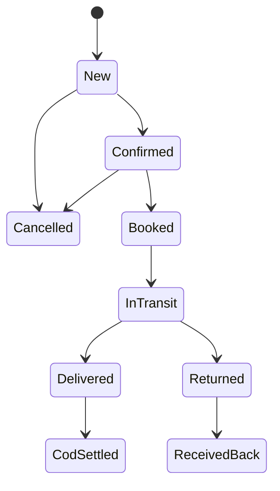

# 13: State machines in the domain and optimistic concurrency

## The idea in plain words

A courier waybill. Each stamp ("booked", "in transit", "delivered") may only follow certain
earlier stamps, and every stamp is logged with who and when. The rules live **on the waybill
itself**, not in each clerk's head: whoever handles it, it cannot jump from New to Delivered.
**Optimistic concurrency** is a version number on the waybill: if two packers pick it up at
once, the second stamp is refused because the version changed underneath, instead of one
stamp silently erasing the other.

## Why we built it this way

- **The lifecycle is data, in the entity.** `OrderLifecycle` holds the allowed moves; `Status`
  has a private setter; `Order.TransitionTo` is the only way to change it, and it appends an
  `OrderStatusChange` (from, to, who, when, note) in the same call. A bulk action, a courier
  sync job or a future endpoint cannot bypass it. An invalid move throws `ConflictException`
  (409) and changes nothing.
- **Tests enumerate the whole space.** 9 allowed pairs are written out from the PRD by hand;
  the other 72 of the 81 pairs are generated and must all throw. A new move in the code
  without a matching PRD change fails a test.
- **Lines are snapshots.** Name, variant label, SKU, unit price and unit cost are copied at
  order time: catalogue edits change future orders only, and profit uses the cost of the day.
- **Money rules in the aggregate.** `Subtotal`, `Total` and `CodAmount` (total minus advance,
  what the courier collects) are computed, never stored twice; advance is 0..total.
- **One aggregate, one boundary.** Lines and history are owned collections: their own tables,
  always loaded and saved with the order.
- **Optimistic concurrency with `xmin`.** Every transition updates the order row, and EF adds
  `WHERE xmin = <version read>`: of two packers, the second save affects 0 rows and throws
  `DbUpdateConcurrencyException`. A unique index on (order, history sequence) is a second
  guard; whichever trips first, the context reports the same concurrency exception.

## Interview questions

1. **Why put the state machine in the entity rather than the service?** Invariants belong
   with the data they protect. In a service, every new caller (bulk job, webhook, admin tool)
   must remember the rules; in the entity there is no other way to change the status.
2. **What happens when two packers update the same order?** Both read version 7. The first
   save writes version 8. The second save's `UPDATE ... WHERE xmin = 7` matches no row, EF
   throws a concurrency exception, the API returns 409, and the client reloads and retries.
   Nothing is lost silently (no "last write wins").
3. **Optimistic vs pessimistic locking?** Optimistic: no locks, detect conflicts at save;
   best when conflicts are rare (one order, many readers). Pessimistic (`SELECT ... FOR
   UPDATE`): hold a lock while working; best for hot rows with frequent conflicts, as with the
   shop row during staff invites (#11).
