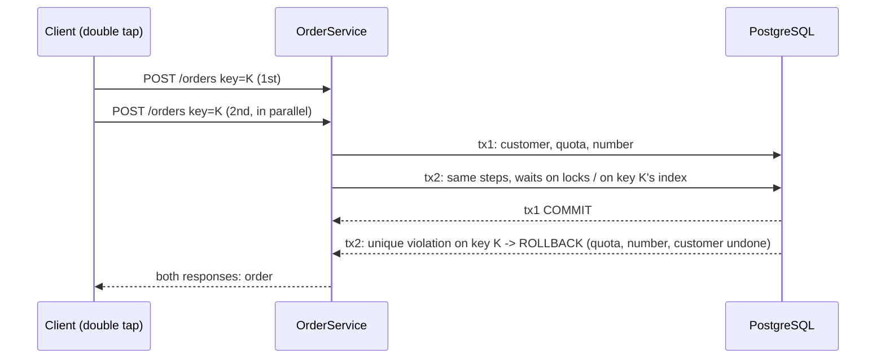

# 14: Idempotency keys and application services that orchestrate aggregates

## The idea in plain words

A numbered order slip. If the shopkeeper is handed the same slip number twice (the seller
double-tapped "Save", or the phone's network retried), they recognise it and hand back the
*same* receipt instead of packing two parcels. The client makes up the number once per form
submission (`Idempotency-Key: <uuid>`); the server stores it **in the same transaction** as
the order it produced.

## Why we built it this way

- **The key lives with the result.** The idempotency record is inserted in the order's
  transaction, so "order exists" and "key used" can never disagree. A crash before commit
  leaves neither; a retry then simply creates the order.
- **Fingerprint the request.** The record stores a SHA-256 of the normalised request (no
  personal data). Same key + same request = replay; same key + different request = 409,
  because silently returning a different order would be worse than an error.
- **Parallel twins are decided by a unique index**, not by a pre-check: the losing
  transaction fails on `(tenant_id, key)`, rolls back everything it did (plan quota, order
  number, a new customer) and replays the winner. Five parallel submits: one order, quota 1.
- **One transaction, ordered steps.** Read-only validation first (no locks held for bad
  input), then customer (#13), quota (#11, atomic), order number (atomic `UPDATE shops ...
  RETURNING`, so a rollback gives the number back), catalogue snapshots (#12), `Order.Create`
  (#14), key. Every request takes locks in the same order, so they cannot deadlock.
- **The service orchestrates, the aggregates decide.** `OrderService` fetches and sequences;
  totals, COD, advance limits and the lifecycle stay inside `Order`. Delivery charge comes
  from the shop settings unless the seller overrides it; prices and costs always come from
  the catalogue, never from the client.
- **Replays look like the original** (201, same body) plus `Idempotent-Replayed: true`.

## Interview questions

1. **How do you make order creation safe against double-clicks and retries?** A client-made
   idempotency key per submission, stored with a request fingerprint and the result in the
   same transaction, enforced by a unique index. Retries return the stored result; reusing a
   key for different content is rejected.
2. **Why not just disable the button?** It helps, but networks retry, users refresh, and
   mobile apps resend after timeouts. Only the server can guarantee "at most once".
3. **What belongs in an application service vs an aggregate?** The service coordinates:
   transactions, loading, calling other modules, idempotency. The aggregate owns the business
   rules for its data (totals, invariants, state changes) so they hold whichever service calls it.
