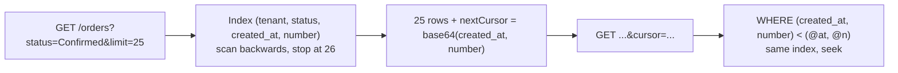

# 15: Keyset pagination, indexes for filters, and partial-success bulk actions

## The idea in plain words

A packer at a warehouse with parcels on shelves sorted **by status, then by date**. "All
Confirmed parcels, newest first" is one shelf, read from the end: no walking the warehouse.
That shelf order is an **index** whose last columns are the sort key.

Paging is a bookmark, not a count. **OFFSET** says "skip 40,000 parcels, then give me 25":
the database still reads and throws away 40,000 rows, and if new parcels arrive meanwhile
everything shifts and you see some twice. **Keyset** says "give me 25 older than the one I'm
holding (`created_at`, `number`)": the index jumps straight there, at any depth.

**Partial success:** when the packer confirms 50 slips and 3 are already cancelled, they hand
back 47 done and 3 refused with the reason for each. They don't refuse the whole stack, and
they don't silently skip the 3.

## Why we built it this way

- **Sort key at the end of the index.** `(tenant_id, created_at, number)` and
  `(tenant_id, status, created_at, number)`. `EXPLAIN` on 50k orders per shop: page 1 reads 7
  buffers; the keyset page at row 40,000 reads 7 buffers in 0.1 ms. The same page with OFFSET
  sorts 40k rows, spills to disk, reads 847 buffers and takes 26 ms (and grows with depth).
- **A unique, deterministic tiebreaker.** Two orders can share a timestamp. A random UUID
  breaks the tie but not in creation order; the per-shop order number is unique and
  monotonic, so "newest first" is exact and the cursor names exactly one row.
- **Row-value comparison** `(created_at, number) < (x, y)` is one index condition. Writing
  it as `a < x OR (a = x AND b < y)` often defeats the index.
- **Opaque cursor** (base64url of the two values). Clients can't build or edit it, and we can
  change what's inside without breaking them. A forged cursor is a 400, not a 500.
- **`limit + 1`** tells us whether there is a next page, without a `COUNT(*)` over the shop.
- **Dhaka days.** "Orders from 20 Nov" means Dhaka midnight to midnight
  (18:00 UTC the day before). One `DhakaTime` helper, shared with billing months.
- **Bulk = one transaction per order.** Each order saves on its own and gets a result:
  `succeeded`, or `error` = `notFound` / `invalidTransition` / `concurrentChange`. The
  response is always 200 with `succeeded` and `failed` counts, so the UI must look at them.
- **Concurrent edits → 409.** The `xmin` row version (from #14) turns two people confirming
  the same order at once into one success and one "reload and retry".

## Interview questions

1. **How do you paginate 100k rows efficiently?** Keyset pagination on an index whose
   trailing columns are the sort key, with a unique tiebreaker: `WHERE (sort, id) < (last)
   ORDER BY sort DESC, id DESC LIMIT n`. Cost per page stays constant, and pages stay stable
   while rows are inserted. The trade-off: no "jump to page 37" and no cheap total count.
2. **How do you report a bulk action where 3 of 50 failed?** Process each item
   independently and return a result per item (ID, success, stable error code, message) plus
   totals. Don't fail the whole batch for 3 bad items, and never drop failures silently. Use
   200 (or 207) and document that clients must read the per-item results.
3. **How do you choose an index for a filtered, sorted list?** Equality filters first
   (tenant, status), then the sort columns in order. Verify with `EXPLAIN (ANALYZE, BUFFERS)`
   on realistic volumes: look for an index scan with no Sort node and a small buffer count.
