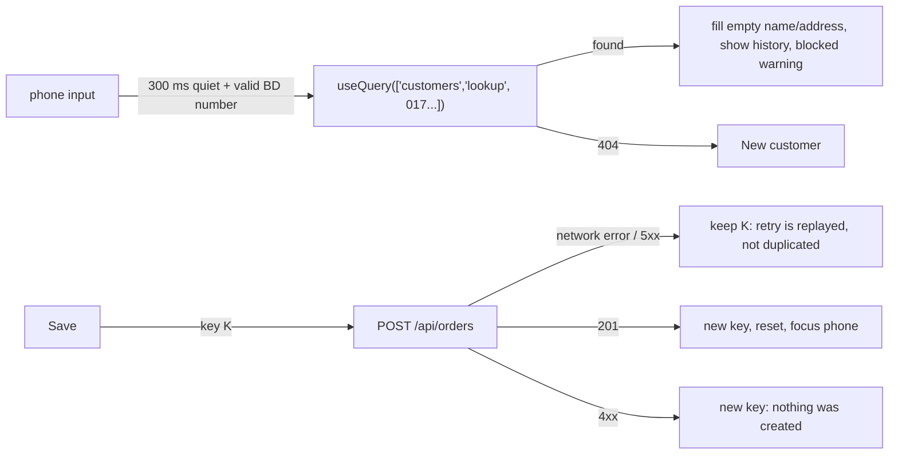

# 16: Form state vs server state, debouncing, and safe retries in a fast form

## The idea in plain words

A shop counter with two notebooks.
- **The buyer's notebook (server state):** what Hishab already knows about a phone number: name,
  address, earlier orders, a block. It's fetched, cached and shared; the form doesn't own it.
- **The order slip (form state):** what the moderator is typing right now. It belongs to this
  screen until it's saved.

Auto-fill copies from the notebook onto the slip, but **only into empty lines** (or lines we
filled ourselves): it never writes over the moderator's handwriting. **Debouncing** means
waiting until they stop typing before checking the notebook. The **idempotency key** is the
slip's serial number: press Save twice, and it's still one parcel.

## Why we built it this way

- **Server state in TanStack Query, form state in React Hook Form.** The lookup is a query
  keyed by the *normalised* phone, so `+880 1712-345678` and `01712345678` share one cache
  entry, and going back to an earlier number is instant. The form never stores the server's
  copy; it only receives a one-way, non-destructive auto-fill.
- **Auto-fill rule:** fill a field only when it's empty or still holds our previous
  auto-fill. Switching numbers replaces our own fill; it never overwrites typed text. Without
  this, a slow lookup that lands after the moderator typed "Rahima Apa" would silently erase it.
- **Debounce plus validity gate.** No request until the number is complete and typing has
  paused: far fewer requests, and no flicker of "new customer" while typing.
- **The key follows the outcome.** Keep it while the outcome is unknown (network error, 5xx:
  the order may exist); drop it once the server has answered for sure (success, or a 4xx where
  nothing was created). A 409 on a kept key means an earlier attempt landed with different
  details, so we tell the user to check the order list instead of guessing.
- **Preview, don't decide.** Totals and cash-to-collect update live from catalogue prices and
  the shop's delivery rate, but the server recomputes everything on save. The client never
  sends a price.
- **Speed on a phone:** phone field focused first; Enter in product search adds the first
  match; the same product again adds quantity; after save the form resets (keeping the
  channel) and focus returns to the phone. Numeric keyboards via `inputMode`; one column at 360 px.

## Interview questions

1. **How do you design a form for speed on a mobile phone?** Ask for the most identifying
   field first and auto-fill from it; minimise taps (Enter-to-add, sensible defaults, keep the
   last channel); use the right keyboards; show live feedback; and after save, reset and refocus
   for the next entry. Measure with a stopwatch on a real low-end phone.
2. **What's the difference between form state and server state?** Server state is a cached
   copy of data someone else owns (it can change, needs refetching and sharing); form state is
   the user's unsaved draft. Keep them in different tools and copy one way only, never
   overwriting the user's input.
3. **When should a client reuse an idempotency key?** For retries of the same attempt whose
   outcome is unknown (timeouts, network errors, 5xx). Generate a new one after a definite
   answer: success, or a client error where nothing was created.
