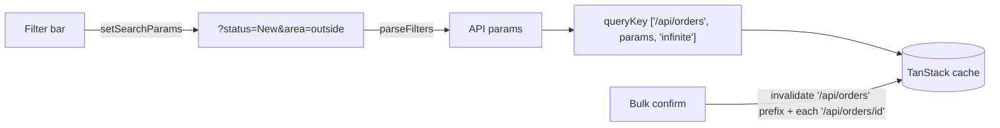

# 17. URL as state, and query invalidation after mutations

## The idea in plain words
**URL as state.** A packer filters orders to "Confirmed, outside Dhaka". If those filters live
only in React state, they live in that one tab's memory: a reload, the Back button or a link
sent to the owner on WhatsApp all lose them. Put them in the URL and the filters are part of
the address, like the label on a warehouse shelf: anyone with the link sees the same view.

**Invalidation.** After a bulk confirm, several cached screens are now wrong (every filtered
list, each changed order's detail). Instead of patching cached pages by hand, we mark those
entries stale and refetch the ones on screen. The server decides what each list now contains.

## How Hishab uses it
- `orderFilters.ts` is the only translation layer: URL to filters, filters to URL (fixed order,
  defaults left out, so equal filters give equal links), filters to API params. URL values
  are untrusted input: unknown statuses or bad dates are dropped, not sent to the API.
- The keyset **cursor is not in the URL**. It is a position inside one result set, not a
  filter, and "Load more" pages hang off the filter key (`useInfiniteQuery`).
- Search applies on submit (one request per search), and the input is re-created when the
  URL changes from outside (Back), so it never shows a stale value.
- Bulk actions send every selected ID; the server's lifecycle decides, and each row shows
  its own result. Failed orders stay selected for another try.
- The single-order confirm writes the returned order straight into its detail cache
  (`setQueryData`), then invalidates the lists.

## Interview questions
1. **Why keep filters in the URL rather than component state?**
   Shareable links, reload and Back work for free, one source of truth (no sync between the
   URL and state), and the query key derives from it. Cost: URL values are untrusted input
   and must be parsed and validated.
2. **Invalidate or update the cache directly after a mutation?**
   Update directly when the response *is* the new cached value (one order's details).
   Invalidate when membership might change (does a confirmed order still match
   `status=New`?): only the server knows, and re-deriving its filters on the client
   duplicates business rules.
3. **What happens to an infinite (keyset) list when it is invalidated?**
   TanStack refetches the loaded pages in order from the first, re-deriving each cursor, so
   pages stay consistent. With many loaded pages this costs N requests; resetting to the
   first page is the alternative when lists get long.
