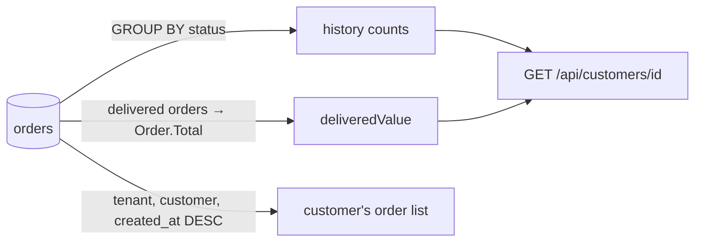

# 18. Read models, derived totals and an index that matches the query

## The idea in plain words
A shop keeps **receipts** (one per sale) and a **ledger page** (totals per customer). The
receipts are the truth; the ledger is derived from them. If someone edits the ledger by hand,
it slowly stops matching the receipts.

In Hishab the `Order` aggregate is the receipt: it guards every change (lifecycle, lines,
concurrency). The customer page asks a different question across many orders: "how many
delivered, returned, cancelled, and how much have they paid for?" That is a **read model**:
a query shaped for one screen that never changes anything.

## Why we used it here
- **Computed on read, not stored counters.** A `delivered_count` column on customers would
  have to be updated by every status change, including future courier syncs and manual fixes;
  one missed path and it is wrong forever. It would also make the customer row a hot lock.
  Computing on read is always right and cheap: one buyer has tens of orders.
- **The domain owns "total".** `Order.Total` (lines + delivery charge) is not a column, so
  `DeliveredValueAsync` loads the delivered orders and sums the domain value instead of
  repeating the rule in SQL. If buyers ever reach thousands of orders, a SQL aggregate or a
  stored total becomes the next step.
- **The index follows the query, including the hidden predicate.** The tenant query filter
  adds `tenant_id = @t` to every query. With `(customer_id, created_at, number)` Postgres
  combined two bitmaps, read all 2,000 rows of a heavy buyer and sorted them (84 buffers,
  0.86 ms). With `(tenant_id, customer_id, created_at, number)` it walks the index backwards
  and stops after 26 rows (6 buffers, 0.09 ms). Equality columns first, sort key last.

## Interview questions
1. **Why compute customer totals on read instead of storing counters?**
   Correctness by construction (no drift, no missed update path) and no write contention on
   the customer row. Store a counter only when reads are too slow, and then rebuild it from
   the source of truth (a projection) rather than hand-maintaining it.
2. **How do you design a composite index for "filter, then sort, then LIMIT"?**
   All equality predicates first (including ones added implicitly, like the tenant filter),
   then the sort columns in sort order, so the database reads rows already ordered and stops
   at the limit. Verify with `EXPLAIN (ANALYZE, BUFFERS)` on realistic data, not guesses.
3. **What is the difference between an aggregate and a read model?**
   An aggregate is a consistency boundary for writes (one transaction, its own invariants).
   A read model is any query or projection shaped for reading, often spanning many
   aggregates; it can be rebuilt and must never be the place where business rules change data.
