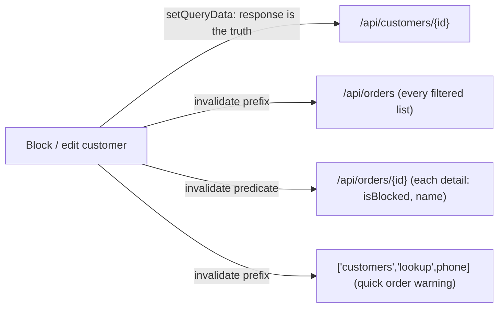

# 19. One change, many caches: invalidation across related queries

## The idea in plain words
An office pins a "do not deliver to this buyer" note on the manager's desk. If nobody copies it
to the packing table and the phone desk, the next order still goes out. A client-side cache
is the same: every screen keeps its own copy of the data it showed, and a change made on one
screen must reach every copy that shows the same fact.

Blocking a customer changes what three kinds of cached queries say:

## How Hishab uses it
- `afterCustomerChange()` in `features/customers/customerQueries.ts` is the single list of
  "who shows a customer". Every customer mutation (edit, block, unblock) calls it, so the next
  screen that shows customers only has to add itself there.
- **Write vs refetch.** The mutation returns the updated `CustomerDto`, which is exactly the
  `customer` part of this page's cache: write it in (`setQueryData`), no extra request. The
  other screens hold shapes we cannot rebuild on the client (an order detail's summary, a list
  page), so they are marked stale and refetched when shown.
- **Prefix vs predicate.** Order details are keyed `/api/orders/{id}` (one string per order), so
  no common prefix exists; a predicate matches them. Slight over-invalidation (other orders'
  details) is cheap: only queries on screen refetch, the rest refetch when next opened.
- The test seeds those caches and checks `isInvalidated`, and a quick mutation check (removing
  one invalidation line) makes it fail, so the rule is guarded.

## Interview questions
1. **After a mutation, how do you decide which queries to invalidate?**
   Ask "which screens display any field this mutation changed?", not "which endpoint did I
   call?". Keep that mapping in one function next to the mutation so it is reviewed and tested.
2. **When is `setQueryData` safe, and when should you invalidate instead?**
   When the response is exactly the cached value (same shape, same server rules). If the cache
   is derived (filters, aggregates, joined summaries), invalidate and let the server recompute.
3. **What does over-invalidating cost with TanStack Query?**
   Little: invalidation marks queries stale; only active (mounted) ones refetch immediately,
   inactive ones refetch when used. Under-invalidation costs more: users act on stale data
   (here, a blocked buyer looking safe).
