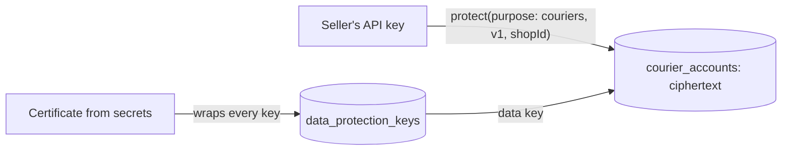

# 20. Courier adapters, and keeping sellers' API keys safe

## The idea in plain words
**Adapter + strategy.** A travel adapter lets one laptop plug work in many countries. Order
code has one "plug" (`ICourierProvider`: validate keys, quote, book, bulk book, status); each
courier gets an adapter (Fake now, Pathao and Steadfast next). A registry picks the adapter by
courier code at runtime. Adding RedX = one class + one DI line; order code never changes.

**Envelope encryption.** A bank box (the ciphertext in `courier_accounts`) opens with a key from
the key cabinet (the Data Protection key ring in Postgres), and the cabinet is locked with a
master key the manager carries (an X.509 certificate from secrets, never in the database).
A stolen database dump holds boxes and a locked cabinet: useless without the certificate.

## Why we used it here
- **Keys must be readable** (we call couriers with them), so hashing is impossible; encryption at
  rest with keys held elsewhere is the next best thing (ADR 0007).
- **Purpose bound to the shop.** The shop ID is part of key derivation, so a ciphertext copied
  into another shop's row fails to decrypt: a tenant-mixing bug becomes an error, not a leak.
- **Keys go in, never come out.** No endpoint returns them; people see `••••abcd`. The ciphertext
  is excluded from the audit log; `CourierCredentials.ToString()` prints `***`.
- **Check before saving, outside the lock.** The courier validates the keys first; only then does
  the transaction lock the shop row for the plan limit (Free = 1 courier). Rotating keys for an
  existing courier is always allowed, even after a downgrade.
- **The Fake courier is deterministic:** same order → same consignment ID; phone ending `0000`
  fails; the key `invalid` is rejected; statuses move only through `FakeCourierControl`.
- Tests prove the claims: the key ring XML is certificate-wrapped (and the test fails if the
  wrapping is removed), the database never holds the plaintext, and a copied ciphertext fails.

## Interview questions
1. **How do you add a new courier without touching order code?**
   Implement `ICourierProvider` (an adapter mapping the courier's API to our contract) and
   register it; the registry resolves it by code. Contract tests per adapter (WireMock.Net)
   keep each one honest against the real API's shape.
2. **How do you store third-party API keys safely?**
   Encrypt with authenticated encryption, keep the data keys away from the data (wrapped by a
   certificate or a KMS), bind ciphertexts to their owner, never return or log them, show a
   masked hint, and plan rotation and loss (reconnect) in advance.
3. **Hashing vs encryption for secrets?**
   Hash what you only need to compare (passwords, OTPs, refresh tokens); encrypt what you must
   use again (courier keys). Hashes cannot be reversed; encrypted data is only as safe as its keys.
