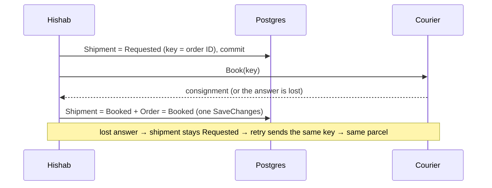

# 21. Booking a courier: idempotency and consistency across a service boundary

## The idea in plain words
You phone a restaurant, place an order, and the line drops before you hear "confirmed". Did
they take it? Calling back and saying "same order, #1043" is safe only if they recognise the
number. Two things make that work: **you wrote down what you were about to order** before
calling (so you know there might be an order out there), and **you use the same order number**
every time you call (so they can say "yes, we already have it").

There is no transaction that spans our database and the courier's. So instead of trying to
make them commit together, we make every step safe to repeat.

## How Hishab uses it
- **Intent record first.** `Shipment` is saved as `Requested` and committed before any network
  call. If we crash after the courier booked, the row proves a parcel may exist.
- **Natural idempotency key.** The merchant reference is the order ID: identical on every retry.
  Creating an order needed a client `Idempotency-Key` header because a new order has no identity
  yet; a booking already has one.
- **Adapters must honour it.** `ICourierProvider.BookAsync` must return the existing parcel for a
  known reference (Fake does by design; real adapters look it up on "duplicate").
- **The database enforces "one live booking per order"** with a partial unique index
  (`state IN ('Requested','Booked')`): two clicks or two couriers cannot both send a rider.
- **Outcomes:** booked → shipment and order change in one SaveChanges; refused → `Rejected`
  (retryable, 400 with the courier's reason); no answer → 503, retry is safe.
- **Known gap:** an order cancelled while the courier was booking leaves a parcel at the courier
  and a `Requested` shipment; it is logged as a warning, and #22's job will reconcile such rows.

## Interview questions
1. **The courier call succeeded but our DB save failed: what now?**
   Because the intent was committed first with a stable key, a retry asks the courier again
   with the same reference and gets the same parcel; then the save succeeds. A background job
   reconciles intents that nobody retried. Without the intent record, we would not know the
   parcel exists.
2. **Why not one distributed transaction (2PC) with the courier?**
   The courier's API does not take part in our transactions, and 2PC couples availability of
   both systems. Idempotent steps plus reconciliation (a saga-like approach) tolerate failures.
3. **How do you stop a double click from booking twice?**
   Same key at the courier, plus a database constraint (partial unique index on live bookings)
   and optimistic concurrency on the save; the loser returns the winner's result or a 409.
