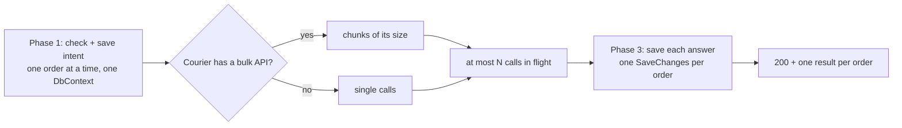

# 22. Bulk booking: batching, bounded concurrency and partial failure

## The idea in plain words
A packer brings 100 parcels to the courier's counter. If the counter takes a whole stack, you
hand over stacks of the size it allows (**batching**). If it only has clerks who take one parcel
each, you use a few clerks at a time, not all 100 at once (**bounded concurrency**). When the
counter refuses one parcel, the other 99 still go out, and you get one receipt per parcel, not
a single pass or fail for the whole lot (**partial failure**).

## Why we built it this way
- **Only the network calls run in parallel.** An EF Core `DbContext` is not thread-safe, so
  checking orders and saving results happen one at a time. Phase 2 touches only the courier
  adapter (a singleton with no state), so `Parallel.ForEachAsync` with `MaxDegreeOfParallelism`
  is safe there.
- **The limit is in config** (`Booking:MaxParallelBookings` = 4, `Booking:MaxBatchSize` = 100,
  checked at startup). Four calls at once is fast enough for a packer and gentle enough not to
  trip a courier's rate limits. 100 orders per request keeps one request well inside HTTP
  timeouts, and the UI can send larger selections as several requests.
- **The adapter says what it supports** (`MaxBulkBookingSize`, null = no bulk endpoint). The
  service never needs to know which courier it is talking to.
- **A failure only affects its own parcels.** A lost answer for one chunk marks only that
  chunk as `courierUnavailable`. An unexpected adapter exception is logged (exception type
  only, since the message could contain personal data) and does not throw away answers that
  already came back. Answers are matched by merchant reference, never by position.
- **Outcomes are saved even if the caller leaves.** Once the courier has answered, the parcel
  exists over there, so phase 3 runs with `CancellationToken.None`. Anything left `Requested`
  is safe to send again, because the reference is still the order ID (note 21).
- **200 with per-order results** (`BulkErrors` codes), the same shape as bulk confirm/cancel.
  Only "no usable courier" fails the whole request (400), because then nothing could be booked.

## Interview questions
1. **How do you book 300 parcels without hammering the courier or timing out?**
   Cap the batch per request (100) and use the courier's bulk endpoint in chunks of its size.
   Without one, use bounded parallelism (a few calls in flight) with per-call timeouts from the
   resilience handler. For thousands of parcels, move to a background job and let the client
   poll for progress.
2. **Why not `Task.WhenAll` over all the orders?**
   It is unbounded: 300 simultaneous calls can trip rate limits, exhaust sockets and the
   connection pool, and a shared DbContext would throw a concurrency error. Use
   `Parallel.ForEachAsync` or a `SemaphoreSlim` to cap calls in flight, and keep the database
   work sequential (or give each worker its own scope).
3. **What does the client get when 97 succeed and 3 fail?**
   200 with one result per order and a stable error code for each failure. The 97 stay booked,
   because each order has its own transaction. The client retries only the failed ones, and
   that is safe because every call is idempotent on the order's reference. (207 Multi-Status is
   the alternative; we chose 200 to stay consistent with bulk confirm/cancel.)
