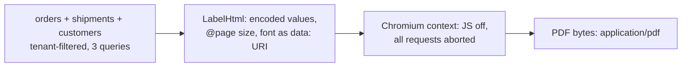

# 25. Server-side PDFs: headless Chromium, font embedding and Bangla shaping

## The idea in plain words
Printing Bangla is like writing in joined-up handwriting: the letters change shape depending on
their neighbours. "ক" + "্" + "ষ" must become one conjunct, "ক্ষ", and the vowel sign in "কি"
is drawn *before* the consonant even though it is stored after it. The program that does this
is a **shaping engine** (HarfBuzz). A PDF library without one types the letters out one by one,
like a typewriter, and the result is unreadable Bangla.

So instead of a PDF library, we use the shaping engine everybody already has: a web browser.
We write the label as HTML and CSS and let headless Chromium "print to PDF", the same as
pressing Ctrl+P.

## Why we built it this way
- **Correct Bangla first.** Chromium uses HarfBuzz, and the font (Noto Sans Bengali, OFL) is
  embedded in the assembly and inlined as a `data:` URI. Output is identical on every machine,
  including font-less Docker images where a "system font" would silently become empty boxes.
- **Untrusted text in a template is an injection risk.** Names, addresses and notes are typed by
  sellers (or pasted from buyers). Every value is HTML-encoded, and as a second layer each render
  runs with JavaScript off and **every network request aborted**. Even a missed encoding can't
  run script or make our server fetch `http://169.254.169.254/...` (SSRF).
- **A browser is a heavy dependency, so we tame it.** One browser per process, started lazily
  and restarted if it dies. A fresh context (like an incognito window) per document. At most two
  renders at a time. A missing browser becomes 503 "try again", never a 500 with a stack trace.
- **CSS does the paper.** `@page { size: 100mm 150mm }` for thermal, A4 with a 2 × 4 grid for
  sticker sheets. Page grouping is plain code (unit-tested), and the integration test counts the
  pages in the real PDF.
- **Licences matter.** QuestPDF would also shape Bangla, but it moved to a dual licence.
  PDFsharp is MIT but has no shaping. Recorded in ADR 0008.

## Interview questions
1. **Generate PDFs on the server or in the browser: trade-offs?**
   Server: same output for everyone, can be emailed, archived or attached, works for API
   clients, but it costs CPU and memory and needs a renderer on the host. Browser
   (`window.print`): no server cost, but output depends on the user's browser, fonts and
   printer settings, and there is no file for integrations. We chose the server because labels
   must be identical and could later be sent to couriers or by email.
2. **Why does a PDF library print Arabic, Hindi or Bangla wrong?**
   Complex scripts need shaping: ligatures, reordered vowel signs, contextual forms. That is the
   job of an OpenType shaping engine such as HarfBuzz. Without one, the library maps each code
   point to a glyph in storage order. You also have to embed (or subset) a font that has the
   glyphs.
3. **What are the security risks of rendering user data with a headless browser?**
   HTML or script injection and SSRF (the browser fetching internal URLs). Defend in layers:
   encode every value, disable JavaScript, block all network requests, render in a throw-away
   context, cap concurrency and time, and never put the user's text into logs or error messages.
