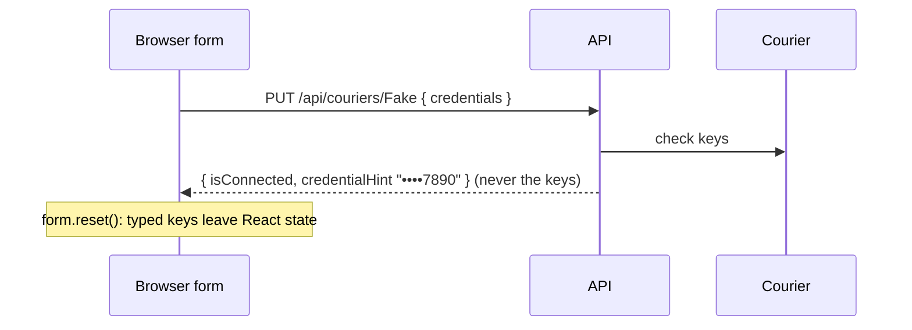

# 26. Write-only secrets in the UI, server-driven forms and file downloads

## The idea in plain words
A hotel safe lets you **set** a code and **set a new one**, but nobody (not even the hotel)
can show you the code that is in it now. Courier API keys work the same way in Hishab: the
seller types them once, the API checks them with the courier, encrypts them (ADR 0007) and
from then on only answers "connected, key ending ••••7890". The UI therefore has no "edit"
for keys, only **replace**: an empty form, every time.

## Why we did it this way
- **Nothing to leak if nothing comes back.** The keys never enter the TanStack Query cache,
  React DevTools, a screenshot or a support session, because the browser never receives them.
  The form is reset after a successful save, so they leave the component state too.
- **Password inputs, plus "Show what I type".** Masking protects against shoulder-surfing in a
  shared shop; a reveal toggle avoids typos in a 40-character key pasted on a phone. It only
  shows what the user is typing now, never a stored value.
- **Server-driven fields.** `GET /api/couriers` lists each courier's fields (`apiKey` for Fake;
  client ID, secret, store, login for Pathao). One form renders them all, so Steadfast later
  needs no UI change. Server errors come back keyed `credentials.<field>`; a rejection of the
  whole set (`credentials`) goes to the form's own error.
- **Downloads, not new tabs.** The PDF arrives after an `await`; browsers block `window.open`
  that is not directly in the click (popup blockers, most phones). A `download` link click
  works everywhere; the object URL is revoked afterwards so the PDF is freed.
- **The UI hides, the API decides.** `canManageShop` / `canPack` only hide buttons; the
  policies on the endpoints are the real checks.

## Interview questions
1. **How should a UI handle a secret the user can set but never read back?**
   Never return it from the API; show a masked hint and the date; offer "replace" with an
   empty form; clear form state after saving; keep it out of caches and logs.
2. **Why not show the old key with a "show" button behind a password prompt?**
   Then the API must be able to decrypt and return it, which widens the blast radius of any
   XSS or stolen session. If the seller lost it, the courier's panel can issue a new one.
3. **Why does "Print labels" download instead of opening a tab?**
   Popup blockers allow `window.open` only inside the user's click; the PDF exists only after a
   network call. A download link works after an await on every browser, phones included.
