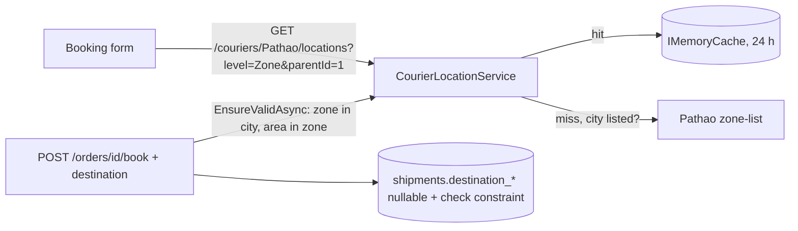

# 27. Caching third-party reference data, and changing the schema without breaking old rows

## The idea in plain words
A courier's list of cities, zones and areas is like a **postal-code book**: every shop uses the
same one, and it changes a few times a year. You keep a copy on your desk and only ring the post
office when it is out of date. Hishab keeps each list in memory for a day, per
(courier, level, parent), so a busy packer opening the booking form 300 times costs Pathao one
call, not 300.

Adding the delivery location to bookings is like adding an optional "flat number" box to a paper
form: old forms without it are still valid. Three **nullable** columns on `shipments` mean every
parcel booked before #66 is simply "booked by address", with no backfill and no table rewrite.

## Why we did it this way
- **Where the IDs live.** Pathao's zone "11" means nothing to another courier, so the destination
  belongs to the *shipment* (one booking with one courier), not the order.
- **Retry safety wins over convenience.** A `Requested` shipment may already exist at the courier,
  so its destination is frozen (409 if a different one is sent). No destination on a retry keeps
  the saved one, and the parcel is always built from the saved intent, so a retry sends exactly
  what the first attempt sent.
- **Validate against the cache, before the intent.** A zone from the wrong city gets a clear 400
  on `destination.zoneId` instead of a vague courier refusal, and nothing is written.
- **Cache hygiene.** Empty lists are not cached, and zones are only fetched for a city the courier
  itself listed, so made-up IDs cannot fill memory or make us spam the courier. An unreadable 200
  is an outage (503), never an empty list cached for a day.
- **Additive migration.** `ADD COLUMN ... NULL` is a metadata change in PostgreSQL: instant, no
  lock-heavy rewrite. A check constraint keeps a destination whole (city with zone, area only
  with them) even for raw SQL fixes.
- **Omit, don't null.** The Pathao serializer now leaves null fields out, so an address-only
  booking is byte-for-byte what it was before.

## Interview questions
1. **When would you move this cache to Redis?** When several instances each fetching once a day
   starts to matter (rate limits), or when you need to invalidate it everywhere at once. Today one
   extra call a day per instance is cheaper than another moving part.
2. **How do you add a column to a large, busy table safely?** Add it nullable with no default (or
   a constant default on PG 11+, also metadata-only), deploy code that tolerates null, backfill in
   batches if needed, and only then tighten constraints.
3. **Why freeze the destination of an unfinished booking?** The courier may already hold a parcel
   for the first destination; changing it and retrying could create two parcels or a mis-routed
   rider. Finish (retry) the same request first, then change it after a rejection.
