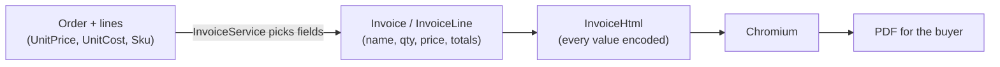

# 28. Allow-list projections: documents that cannot leak

## The idea in plain words
A restaurant bill is printed from what the waiter rang up (dish, quantity, price), never from
the kitchen's cost sheet. However the bill is styled, it *cannot* show the food cost, because
that number never reaches the printer.

Hishab's invoice works the same way. The order knows each line's cost (for profit reports),
but the invoice template receives an `Invoice` / `InvoiceLine` record with **no cost field at
all**. "Cost prices never appear" is a property of the type, not something every future template
edit has to remember. A reflection test fails if anyone adds a `Cost`, `Margin`, `Profit` or
`Sku` property to those records.

## Why we did it this way
- **Allow-list over deny-list.** "Copy the order, hide the cost" fails open: the next new field
  (say, supplier name) leaks by default. "Copy only these fields" fails closed.
- **Separate from permission checks.** Owners may see costs on screen (`SeeProfit`), but an
  invoice goes to the buyer whoever prints it, so the rule lives in the document type, not the role.
- **One encoder, one font.** `PrintHtml` holds the embedded font and the HTML encoder for labels
  *and* invoices: a second copy would be a second place to forget encoding (XSS or SSRF through a
  buyer's name inside a headless browser).
- **Dhaka date, not UTC.** An order taken at 01:30 in Dhaka is printed with that day, through the
  same `DhakaTime` helper the order list uses.
- **Same guards as labels.** Tenant filter on all three queries (another shop's ID is a 404),
  cancelled orders refused with their numbers (400), and at most 100 per PDF.

## Interview questions
1. **Why is an allow-list safer than hiding fields in the template?** New fields are hidden by
   default; the safe state needs no action. Deny-lists need every future change to remember them.
2. **How would you prove a sensitive field never reaches a document?** Make it unrepresentable
   (the type has no such member), guard that with a test, and keep a template test for the output.
3. **Why HTML-encode values that go into a PDF?** The PDF is made by a browser engine: an
   unencoded `` in an address could run markup or reach internal hosts.
