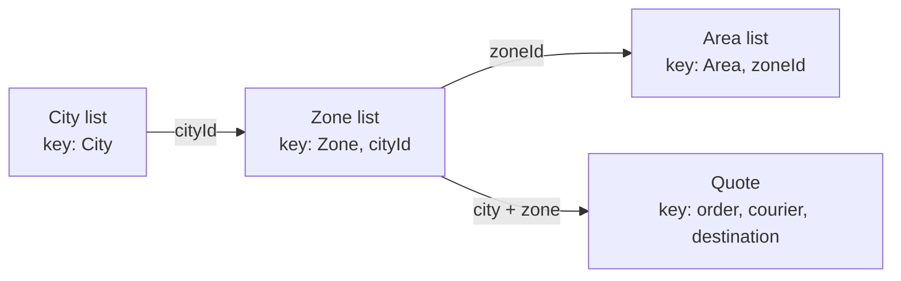

# 29 · Cascading dependent selects with TanStack Query

## The concept
A cascading select works like a postal form: first the district, then a thana inside it, then a
union inside that. Each list depends on the one above it, and changing a parent makes every choice
below it meaningless, so those choices are cleared.

In TanStack Query each level is **its own query, keyed by its parent**:
`['/api/couriers/Pathao/locations', { level: 'Zone', parentId: '1' }]`. That gives us three things
for free:

- **No refetch on re-render.** The key is the only input; same key = same cache entry.
- **Instant "back".** Choose Dhaka, then Chattogram, then Dhaka again: Dhaka's zones are still in
  the cache (a test asserts exactly one request for them).
- **Only necessary waits.** A level is `enabled` only once its parent is chosen. The chain
  city → zone → area is a true dependency, not a waterfall caused by component nesting.

## Why we used it here
Pathao prices by city and zone. The packer picks them on a phone, so we use native `<select>`s
(the phone's own picker, keyboard type-ahead, no new library), plus a filter box once a list has
more than 8 entries. The **quote** is a `useQuery`, not a mutation: `POST /quote` saves nothing, so
it is a read with a body. Keying it by the destination means each zone is priced once, and
`keepPreviousData` keeps the old price (greyed) while the new one loads.

Two failure modes were designed out:
- **Stale child IDs.** Changing the city clears zone and area; changing the courier clears
  everything (location IDs belong to one courier). Otherwise we could send zone 21 under city 1.
  The server still checks it (`EnsureValidAsync`), but the UI should not create the error.
- **Silent downgrade.** A city without a zone disables "Book". Sending it would quietly become an
  address-only booking, the very inexact price this feature exists to avoid.

The booked shipment stores only IDs; the panel turns them into names from the same cached lists.

## Interview questions
1. **Why one query per level instead of one query that loads the whole tree?**
   The tree is large (cities × zones × areas). Per-level keys fetch only what the user opens, cache
   each branch independently, and let the server cache per level too.
2. **Your endpoint is a POST. Why is it a `useQuery`?**
   HTTP verb is transport; what matters is side effects. A safe, repeatable read can be cached,
   deduplicated and refetched; mutations cannot. We set `retry: false` because a courier error
   (400) will not fix itself.
3. **How do you stop a dependent query from firing with an empty parent?**
   `enabled: parentId !== null`. The key still includes the parent, so when it arrives the query
   starts under the right key, and an older parent's response can never land under the new one.
