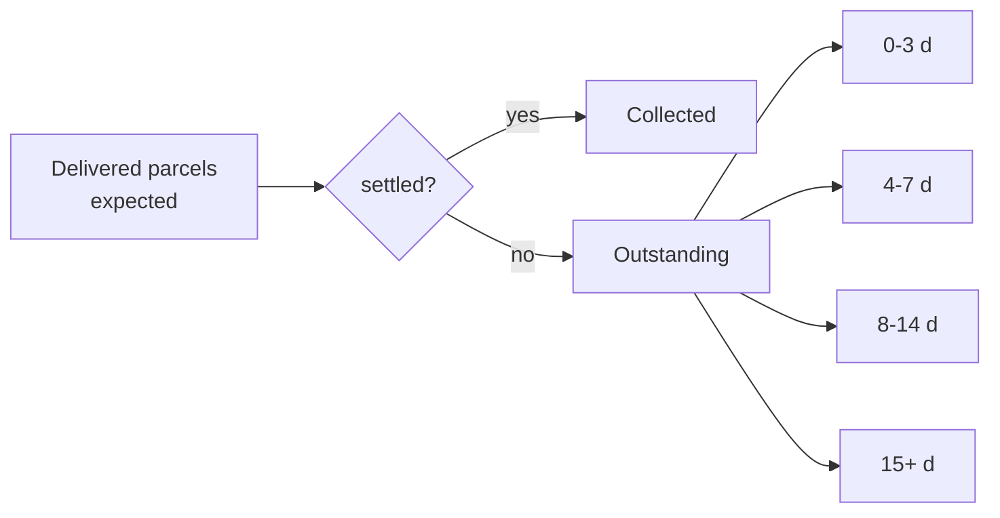

# 30 · Reconciliation: COD expected vs collected

## The concept
Reconciliation is checking two records that should agree and explaining every difference. A
bank statement against your chequebook is the classic case. Here the two records are **what the
courier collected for us** (every delivered parcel's COD amount) and **what the courier paid us**
(settled parcels). The difference is **outstanding** cash: money the shop has earned but not received.

A single total hides the problem. "৳18,000 outstanding" is normal if it is all from yesterday,
and alarming if half of it is three weeks old. So outstanding is **aged** into buckets
(0-3, 4-7, 8-14, 15+ days) and the oldest unpaid parcel is called out.

## Why it is built this way
- **Pure domain function.** `CodReconciliation.Summarize(parcels, now)` takes plain rows and
  "today", so the rule is unit-tested without a database or clock. The service only loads data.
- **One invariant.** `Expected = Collected + Outstanding`, per courier and in total. Every amount is
  an exact sum of two-decimal `Money` (decimal), so it always holds. With `double`, summing 1,000
  parcels of ৳0.10 does not give exactly ৳100 (a unit test checks this).
- **Dhaka days, not 24-hour periods.** A parcel delivered at 23:30 is "1 day old" the next morning.
  Ages use `DhakaTime.DayOf`, the same rule as billing months.
- **One source for the money rule.** COD due is `Order.CodAmount` (lines + delivery - advance). We
  load orders and use that property rather than re-writing the formula in SQL.
- **Nothing silently dropped.** A delivered order without a booked shipment is still owed: it
  appears under a "no courier" row instead of vanishing from the totals.
- **Collected = CodSettled orders for now.** #28 adds payouts and matching. Short or late payouts
  then become a matched amount below the due amount, and the API shape stays the same.

## Interview questions
1. **How do you keep a reconciliation correct when payouts arrive late or partially?**
   Keep expected and received as separate facts and derive the difference; never overwrite one with
   the other. A late payout simply moves a parcel from outstanding to collected when it is matched;
   a partial one leaves a visible shortfall for that parcel instead of hiding it in a total.
2. **Why `decimal` and not `double` for money?**
   `double` is binary floating point: 0.1 has no exact representation, so sums drift by fractions
   of a paisa and totals stop matching. `decimal` is base-10 and exact for currency amounts.
3. **This loads every delivered order. When does that stop scaling, and what then?**
   At tens of thousands of settled orders per shop. Then store the COD amount on the order when
   it is confirmed (it no longer changes), aggregate in SQL with an index on
   `(tenant_id, status)`, or keep a running per-courier ledger updated in the same transaction.
