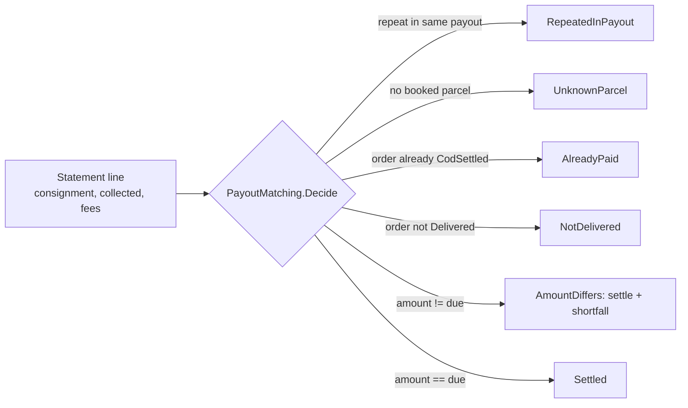

# 31. Payout reconciliation: double-entry thinking and idempotent imports

## The concept in plain words

A courier does not pay per parcel. Every few days one transfer arrives with a statement:
"for these 40 parcels we collected ৳48,000, kept ৳2,400 delivery and ৳480 COD fees, here is
৳45,120". **Reconciliation** means proving that every taka in the transfer is explained by a
line, and every line points at a parcel we actually delivered.

**Real-world analogy:** a shopkeeper checking the wholesaler's delivery note against the boxes
on the floor. Short a box? Write it on the note *now*, in red. Don't adjust the total so it
"looks right", because then nobody can chase the missing box.

**Double-entry thinking:** amounts never appear or vanish. They move between named buckets, and
each identity must hold exactly:

```
payout:   netAmount = collected - deliveryFees - codFees + difference
summary:  expected  = collected + shortfall + outstanding        (per courier)
```

`difference` and `shortfall` are the "red ink": stored and shown, never rounded away.

**Idempotent import:** entering the same statement twice must not count the money twice.

## Why we built it this way here



- **Rules are a pure function** (`PayoutMatching.Decide`), unit-tested without a database. The
  service only looks the parcels up and saves.
- **One SaveChanges** saves the payout, its lines and every Delivered -> CodSettled step. The
  books can never show settled orders without the payout that paid them.
- **Short payments settle and stay visible** (Syed's choice): the order is done from the
  seller's side, and the gap shows on the line (`shortfall`) and in the COD summary.
- **Mismatches are saved, not rejected**: the money arrived, so we record it. A line that
  matched nothing settles nothing and keeps its reason (re-matching: #76).
- **Three locks against double counting:** a pre-check on (courier, reference) gives a clear
  409; a unique index on it handles two people entering the same statement at once; and a
  partial unique index on `payout_lines.settled_shipment_id` (plus the order's `xmin`) means
  a parcel is settled by exactly one payout, even when two payouts race.

## Interview questions

1. **A payout amount does not equal the sum of its parcels. How do you surface and resolve it?**
   Store the payout as received and compute `difference = net - (collected - fees)`. Never
   adjust a line to make it balance. Show the difference on the payout and per-line shortfalls
   on parcels, so someone can raise a claim with the courier. Resolution is a new entry (a
   correction or claim), not an edit that rewrites history.
2. **How do you make "import a statement" idempotent?** Give it a natural key (courier +
   statement reference) with a unique constraint, and make each side effect unique too (one
   settling line per shipment). A pre-check gives a friendly error; the constraint is the real
   guarantee under concurrency.
3. **Two payouts listing the same parcel are saved at the same moment. What happens?** Both
   read the order as Delivered. The first commit wins; the second fails on the order's row
   version or on the partial unique index and gets a 409. On retry it sees the order settled
   and records the line as AlreadyPaid. The cash is never counted twice.
