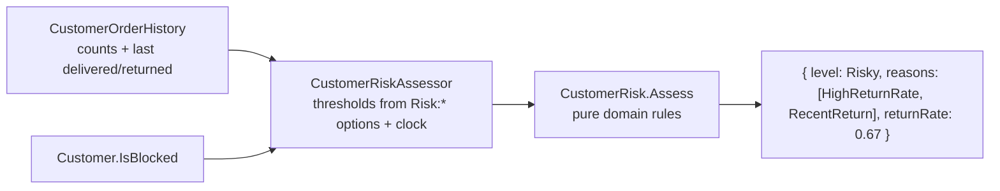

# 32. Explainable risk rules and domain services

## The concept in plain words

A **risk score** turns a buyer's history into a decision aid: ship normally, call first, or ask
for the delivery charge in advance. There are two ways to build one:

- **Rules:** a few thresholds a person can read ("2+ returns and half or more of parcels
  returned = Risky"). Every verdict comes with its reasons.
- **A model (ML):** learns weights from lots of labelled data. It can be more accurate, but it is
  opaque, needs data we don't have yet (tens of orders per buyer), and drifts silently.

**Real-world analogy:** a shopkeeper's memory of regulars. "She took 12 parcels and refused one a
year ago, fine. He refused the last two: ask for advance." The shopkeeper can always say *why*.

A **domain service** is business logic that doesn't belong to one entity. The score uses the
customer's block flag *and* their orders' outcomes, so it lives in a stateless
`CustomerRisk.Assess(history, thresholds, now)`: pure, with no database and no clock of its own.

## Why we built it this way here

- **Four levels, not three** (Syed's choice): `New` means no history. A green "Safe" for a buyer we
  know nothing about would hide exactly the case fake orders come from.
- **All reasons are returned**, not just the worst one, so the UI (#33) can say *why*, and a seller
  who disagrees can unblock the buyer or ask for an advance.
- **Recency with forgiveness:** a return counts as "recent" for 90 days, unless a parcel was
  delivered after it.
- **The order on screen never counts against itself**: order details exclude it from the history.
- **Thresholds in configuration** (`Risk:*`, checked at startup by `ValidateOnStart`): an
  inconsistent set, such as a Risky rate below the Watch rate, stops the app instead of silently
  mislabelling buyers.
- **This shop only:** the tenant filter scopes the history, and a test proves another shop's
  returns don't follow the phone number.

## Interview questions

1. **How would you evolve this into a shared risk network without leaking personal data?**
   Opt-in only. Each shop contributes outcome counts keyed by a keyed hash of the normalised
   phone (HMAC with a server secret, not a plain SHA-256 that can be brute-forced over the small
   phone-number space). Show counts, never which shop or order. Use minimum-k thresholds (show
   nothing below 3 contributing shops) and let a shop's own history outweigh the network.
2. **Why rules instead of ML here?** There's too little data per buyer to train on, sellers need
   reasons they can act on, and rules are testable edge case by edge case. Collect labelled
   outcomes now; a model can later be one more input, scored against the rules offline before it
   replaces anything.
3. **Where does the risk logic live, and why not in the controller or SQL?** In a pure domain
   service. It's unit-tested without a database, reused by lookup, the customer page and order
   details, and thresholds are injected so tests can vary them. SQL only fetches the counts and
   dates.
