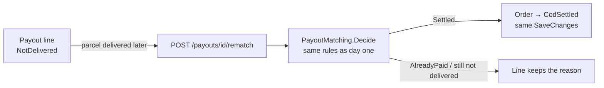

# 33. The reverse leg and re-matching

## The concept in plain words

A parcel that comes back has **two events**, just like one that is delivered:

- **The courier says "returned"**: a status, which the sync job already records.
- **The box is back on the shop's shelf**: a physical receipt the packer confirms
  (Returned → ReceivedBack), together with what the courier charged to carry it back.

The **return charge** is a real cost. Without it, a shop with a 20% return rate thinks it earns far
more than it does, and that is exactly the "real profit" (#30) Hishab promises.

**Re-matching** is the accountant's second pass over a bank statement. Some lines could not be
matched on the day the payout was entered: the parcel was still in transit, or our booking had not
been recorded yet. Once the facts catch up, the same rules run again on those lines only.

**Real-world analogy:** a shop ledger. A receipt you could not place on Monday gets pinned to the
right invoice on Friday. The receipt's amount never changes; only *what it pays for* gets filled in.

## Why we built it this way here

- **Receiving is a packer job; the charge is a profit fact.** `receive-back` needs `CanPack`.
  Sending a charge needs `SeeProfit` (checked in the service, not only on the endpoint). A packer
  receives without a charge, and the owner adds it later with `PUT /return-charge`. Syed chose that
  over "charge only at receipt", which would leave costs missing forever.
- **The charge lives on the Shipment**: it is the courier's price for this parcel, next to the
  delivery fee. Status and charge are saved in one SaveChanges, so both are saved or neither.
- **Only UnknownParcel and NotDelivered lines re-match.** Settled, AlreadyPaid and RepeatedInPayout
  are final. Amounts never change, so the payout's Difference stays the same and the books still
  balance.
- **Settling twice is impossible.** Re-match reuses `ux_payout_lines_settled_shipment`, the
  unique index that stops two payouts settling one parcel, and the orders' `xmin`. A race ends as a
  409, never as cash counted twice. Running it again is harmless (idempotent).
- **Manual, not automatic** (Syed's choice): staff press "re-match" (#32). Status sync stays
  unaware of payouts, so the two modules don't depend on each other.

## Interview questions

1. **Why model "returned" and "received back" as separate states?**
   They are different facts from different sources: the courier's claim, and our own hands on the
   box. Parcels get lost between the two. Keeping both lets the shop chase returns that never
   arrived, and restock only what is really there.
2. **How do you make re-matching safe to run twice or in parallel?**
   It re-decides only non-final lines with the same pure rules. It changes no amounts. A unique
   index on the settling column, plus row versions on orders, turns any race into a 409. The second
   run finds nothing left to do.
3. **The UI hides cost fields from packers. Why also check in the service?**
   The UI is not a security boundary: any client can call the API. The service checks
   `IRequestContext.Has(SeeProfit)` both before writing a charge and before returning one, so every
   caller (bulk actions, jobs, future endpoints) gets the same rule.
