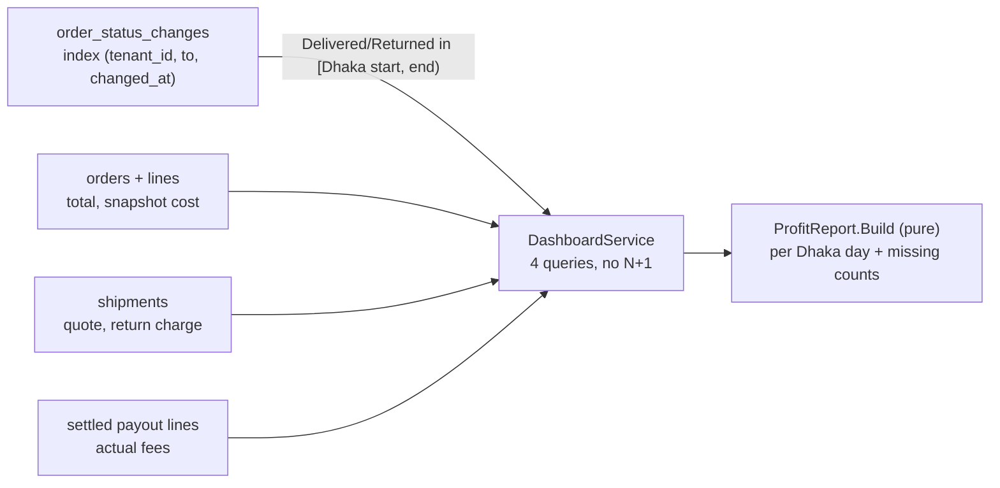

# 34. Reporting read models and time zone bucketing

## The concept in plain words

The order tables are built for **writing**: one order at a time, with its lines and history,
consistent and locked. A report wants the opposite shape: **many orders, summed by day**. A *read
model* is a query, or a table, shaped for that question rather than for the write.

**Time zone bucketing:** "today" is a Dhaka day (UTC+6). A parcel delivered at 00:30 in Dhaka is
18:30 UTC *the day before*. Bucket by UTC date and every early-morning delivery lands on the wrong
day, and month-end totals drift.

**Real-world analogy:** the end-of-day tally in a shop. You don't re-read every receipt ever
written; you take today's pile (an index range), add it up, and write it down by the shop's own
clock, not London's.

## Why we built it this way here

- **Computed on read, not pre-aggregated.** It's one source of truth, with nothing to keep in sync.
  A month for one shop is a few thousand parcels. A daily rollup table becomes worth it when that
  load gets slow, or when reports span years.
- **`tenant_id` copied onto status history** (Syed's choice). History rows had no tenant, so "this
  shop's deliveries this month" would have had to range-scan *every* shop's deliveries. It's a shadow
  property: SaveChanges stamps it on new rows and the migration backfilled existing ones. The
  domain class is unchanged.
- **Sales count on the delivery day** (Syed's choice); returns count on the return day. Cash timing
  stays on the COD screen.
- **Real figures first:** fees come from the courier's payout when it has paid, otherwise from the
  booking quote. **Unknown figures count 0 and are reported** (`missing`: lines without cost,
  returns without a charge, parcels awaiting payout), never estimated. A precise-looking guess is
  worse than an honest gap.
- **Pure formula:** `ProfitReport.Build` is unit-tested without a database, and every day in the
  range is listed, so a chart shows the gaps.

## Interview questions

1. **Compute reports on the fly or pre-aggregate? When would you switch?**
   On the fly while the data per request is small and indexed (one shop, one month). Switch to
   rollups (a summary table updated on each status change, or a nightly job) when p95 latency grows,
   reports span years, or many users load the same numbers. Keep the raw data as the source of
   truth so rollups can be rebuilt.
2. **Why bucket by the shop's time zone, and how do you query a local day?**
   People think in local days. Convert the local day's start and end to UTC instants
   (`DhakaTime.StartOfDay`) and query a half-open range `[start, nextStart)`. Never cast stored
   timestamps to dates in UTC.
3. **Why add a tenant column to a child table that can already join to its parent?**
   An index can only use columns in its own table. Filtering by the parent's tenant after the join
   means scanning every tenant's child rows in the date range first. Copying the tenant onto the
   child makes "this shop, this status, this period" one index range. The cost is a column, plus a
   stamp on insert.
