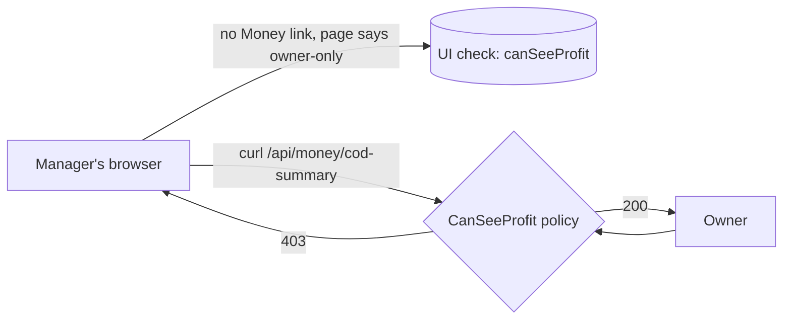

# 36 · Role-aware UI vs server enforcement

## The concept in plain words
A shop puts a "Staff only" sign on the office door and a lock on the cash drawer. The sign keeps
honest people from wandering in; only the lock stops someone who ignores it. In a web app, hiding a
menu link or a button is the sign: it is **UX**. The API's authorization check is the lock: it is
**security**. Everything in the browser (JavaScript, the role claim it reads, the hidden route) is in
the user's hands: they can open DevTools and call `GET /api/money/cod-summary` directly.

## Why we used it here
- `canSeeProfit` (Owner only) mirrors the API's `RolePermissions` matrix and decides what to *show*:
  the Home link, the three money pages. The pages also pass `enabled: false` to their queries so a
  Manager does not even trigger a 403 round trip.
- The API still enforces `CanSeeProfit` on every `/api/money/*` endpoint (tests from #27/#28). If the
  two ever disagree, the user sees an error, never data: the safe failure direction.
- The form validates amounts (≤ 2 decimals) and shows a live "statement net vs. money received"
  check, but these are *conveniences*. The server recomputes totals and re-validates, and its
  unique (courier, reference) index turns a double-submitted payout into a 409 that we show as a form
  error. That is why this form needs no idempotency key, unlike quick order.
- One `afterPayoutChange` function refreshes every screen that a payout changes (payout, list, COD
  summary, reports, the orders it settled), so stale money figures cannot linger.

## Interview questions
1. **"You hid the button. Is the feature secure?"** No. Hiding is UX. Security lives at the API
   (policy per permission, checked from the signed token's role claim) and, for field-level rules,
   in the service (`IRequestContext.Has`). Test the API with a forbidden role and expect 403.
2. **"Why duplicate the role matrix in the frontend at all?"** To avoid showing actions that will
   fail (a dead button is a bad experience) and to skip pointless requests. The copy is display-only;
   drift is caught because the API test matrix is the source of truth, and the worst case is a
   visible error, not a leak.
3. **"How do you stop a seller recording the same payout twice when they double-click?"** Natural
   idempotency: the statement reference is unique per courier in the database, so the second insert
   fails with 409 and nothing settles twice. The button is also disabled while pending, but that is UX:
   two tabs could still race, and only the unique index stops that.
