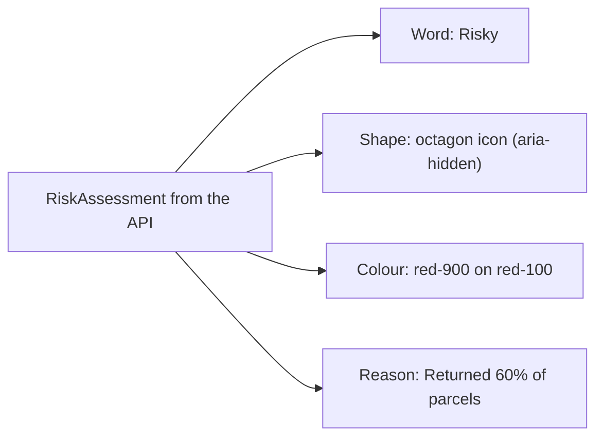

# 37 · Accessible colour-coded status, and charts people can read

## The concept in plain words
A traffic light works for colour-blind drivers because **position** (top, middle, bottom) carries
the meaning; the colour only reinforces it. About 1 in 12 men cannot tell red from green, screen
readers do not see colour at all, and a phone in sunlight washes colours out. So a status badge must
say what it means in **words**, ideally with a second visual cue (a distinct **shape**), and use colour
as the third signal, with enough contrast (WCAG AA: 4.5:1 for small text).

A chart is the same problem at a larger size: the picture is for quick reading, but the **numbers
must also exist as text** (a caption that summarises, a table that lists).

## Why we used it here
- `RiskBadge` shows New / Safe / Watch / Risky as text, a different Lucide icon per level (circle
  dashed, check, triangle, octagon), and 900-on-100 colours. The icon is `aria-hidden`: screen readers
  hear the word once. Reasons are visible text, not a tooltip (tooltips fail on touch screens).
- The order list needed risk per row. Asking per row is the **N+1 problem** (50 rows = 100+ queries);
  `ForManyAsync` groups by (customer, status) for the whole page: always two queries. A shared `Build`
  keeps the list's answer identical to the customer page's (an integration test compares them).
- The profit chart: one series, so no legend (the title names it); a colour checked by the dataviz
  validator; losses read by position below the zero line; a caption with the totals; a "Show as a
  table" view; the SVG is `aria-hidden` because the caption and table carry the same numbers.
- Recharts is lazy-loaded (its own ~119 KB gzip chunk), so only Owners, who see the chart, download it.

## Interview questions
1. **"How do you make a colour-coded badge accessible?"** Never colour alone: a text label, a second
   cue such as an icon shape, contrast of at least 4.5:1, decorative icons hidden from screen readers,
   and the reason in visible text rather than a hover tooltip.
2. **"Your list shows a computed value per row. How do you keep it fast?"** Batch it: collect the
   page's IDs and run one grouped query (`WHERE customer_id IN (...) GROUP BY customer_id, status`),
   so the query count is constant per page. Watch for N+1 in code review and with a query-count test or
   logs.
3. **"How is a chart accessible to a screen-reader user?"** Give the data a text form: a caption that
   states the takeaway and a real table. Hide the purely visual SVG so the numbers are not read twice,
   make controls real buttons with `aria-pressed`, and avoid motion that serves no purpose.
