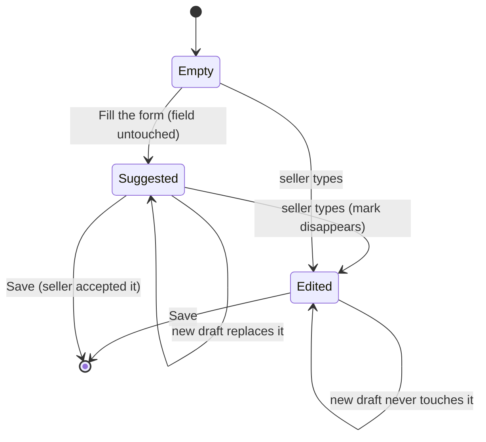

# 39 · Human-in-the-loop UX for AI suggestions (#35)

## The idea in plain words

A satnav suggests a route; the driver still drives. Good AI UX works the same way: the suggestion
is **visible as a suggestion**, **easy to check against its source**, **cheap to override**, and
**never acts on its own**. Hishab's AI reads a Messenger chat and fills the order form, but the
seller stays the one who decides, because the AI will sometimes be wrong (wrong number, wrong size,
a scarf we do not sell).

## What we built and why

| Rule | In Hishab |
| --- | --- |
| Show what the AI did | Each filled field has a **✦ Suggested** mark: a word and a symbol, not colour alone (colour-blind users, screen readers read "Customer name, Suggested"). |
| Keep the source beside it | The pasted chat stays open above the form, so the seller compares without switching apps. |
| Never overwrite a human | A suggestion fills a field only if the seller has not typed in it (React Hook Form's `dirtyFields`) or it still holds an earlier suggestion. |
| The mark tracks the truth | A field is "suggested" only while its value equals the suggestion; editing it removes the mark, with no extra state to keep in sync. |
| Say what it could not do | Items not in the catalogue and warnings ("more than one number") are listed in a live region, never dropped silently. |
| No action without consent | The draft endpoint saves nothing; Save is the confirmation, and the server validates the order again. |
| Fail to manual | 503 / 429 show a plain message and leave the form as it was: the 20-second manual flow always works. |

**Trade-off:** we do not force the seller to tick every suggested field before saving. That would
be safer but would break the "order in under 20 seconds" promise; marks + a clear banner are the
middle ground. If wrong AI orders show up in returns, a "confirm each mark" step is the next lever.

**Testing gotcha:** MSW uses the first matching handler. The generic `*/api/orders/:id/:action`
fake also matched `/api/orders/drafts/from-chat`, so the specific handler must be registered first.

## Interview questions

**1. How do you design UI around an AI suggestion that may be wrong?**
Make it visibly a suggestion (labelled, not colour-only), show its source next to it, never overwrite
user input, make overriding a one-step edit, surface what it was unsure of, and require an explicit
human action before anything is committed. Failure must fall back to the manual path.

**2. How do you decide whether a field is still "AI-filled" after the user interacts with it?**
Derive it instead of storing it: keep the suggested value and compare it with the current value. If
they differ, the human owns the field. Derived state cannot drift out of sync with the form.

**3. When would you add friction (e.g. a confirmation per field) to an AI-assisted flow?**
When the cost of an unnoticed error is high relative to the time saved: money moving, legal text, or
here if returns traced to AI drafts rise. Measure the error rate first, then add friction where it pays.
