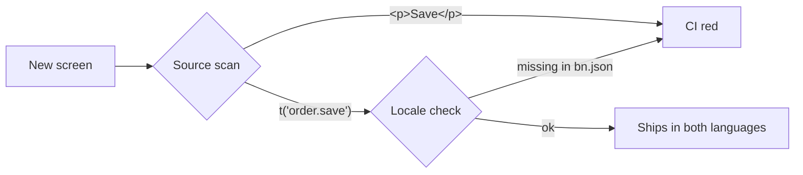

# 40 · i18n vs l10n, and stopping untranslated text from shipping (#36)

## The idea in plain words

A bus has a destination sign that can show any text: that is **internationalisation (i18n)**, building the
product so it *can* speak any language. The sign actually reading "মিরপুর ১০" is **localisation (l10n)**:
words, digits, dates, money and fonts that feel native to one place. i18n is an engineering property; l10n is
content plus local rules.

| i18n (the capability) | l10n (the content and rules) in Hishab |
| --- | --- |
| No text in components, only `t('key')` | `bn.json` written by a Bangla speaker, not machine-copied |
| Plurals by rule, not `count + 's'` | `Intl.PluralRules('bn')` → `one`, `other` |
| Numbers and dates via `Intl` | "১২,৪৫০.০০৳", "২৬ নভে", Dhaka time zone |
| `<html lang>` follows the choice | Screen readers use a Bangla voice; CSS loads Noto Sans Bengali |

## What we built and why

- **Bangla first, remembered.** First visit = Bangla (the PRD's sellers); the choice is saved on the device and
  mirrored to `<html lang>`. Saved values are untrusted: `fr` or junk falls back to the default.
- **Digits follow the reader.** `{{count, number}}` makes i18next run `Intl.NumberFormat` with the current
  language, so "১২টি পণ্য" needs no component change. Bare counts use `formatNumber`. *Identifiers stay ASCII*
  (order #1043, phones): couriers and statements print them that way, and people search by them.
- **The font costs nothing in English.** `@fontsource` ships woff2 files split by `unicode-range`, and the font is
  only named under `html:lang(bn)`; English pages never download it.
- **The guard runs in CI.** Two Vitest tests (`npm test`, already in CI):
  1. locales: same keys and same `{{placeholders}}` in every language, every plural form the language needs, no
     empty text, no unformatted `{{count}}`;
  2. source scan with the TypeScript compiler (already a dependency, no lint plugin): no text typed directly in
     JSX or in `aria-label` / `placeholder` / `title` / `alt` / `label`, and every literal `t('key')` exists.

**What the guard cannot see.** Values that reach the screen as *data* are not caught: the role name came straight
from the API ("Owner হিসেবে…") and was only found by looking at Bangla screens at 360 px. The same applies to
server error messages (still English) and native widgets: `<input type="date">` shows the browser's format. So the
automated checks are a floor; a Bangla screenshot pass per UI PR is the rest.

## Interview questions

**1. What is the difference between i18n and l10n?**
i18n is making the code locale-neutral (externalised strings, `Intl` formatting, plural rules, direction, fonts);
l10n is supplying one locale's content and conventions. You do i18n once per feature and l10n once per language.

**2. How do you stop untranslated strings from shipping?**
Make it a failing build, not a review comment: key parity and placeholder checks across locale files, a static
scan for literal JSX text and literal keys, plural-category checks from `Intl.PluralRules`, plus screenshots in
the target language for what static checks cannot see (API data, native controls).

**3. Why not concatenate numbers into strings, or add "s" for plurals?**
Word order, digits and plural categories differ by language (Arabic has six plural forms, Bangla uses its own
digits). Pass values into the message and let the message plus `Intl` decide.
