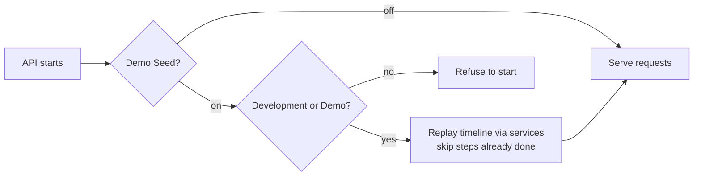

# 41 · Environment-specific seeding: a demo shop that can never reach production (#37)

## The idea in plain words

A furniture showroom has a staged flat: beds made, a fruit bowl on the table, but nobody lives there and the
plastic fruit never leaves the shop. Demo data is the same: it must look lived-in (a month of orders in every
state, a risky buyer, a short-paid parcel), it must be **obviously fake** (no real person's phone), and it must
**stay in the showroom** (never in a production database).

| Concern | How Hishab handles it |
| --- | --- |
| Stays in the showroom | `Demo:Seed` is read only by the startup hook, which **refuses to start** outside an allow-list (Development, Demo). An allow-list, not "not Production": a new "Staging" or a typo never seeds. |
| Obviously fake | Every phone is in `+880 10 0000 0xxx`. 010 is not issued to any operator, so a stray SMS cannot reach anyone. `Phone.IsDemo` makes it checkable, and a test asserts it for every seeded person. |
| Looks real | The seeder goes through the **real services** as the demo owner, so order numbers, history, snapshots, courier booking, status sync and payout matching all follow production rules. A `SeedClock` moves the app clock through a four-week timeline, so the profit chart has history. |
| Re-runnable | **Convergent**, like Terraform: each step checks whether it already happened (SKU exists, staff invited, order history contains the status, payout reference recorded). Orders reuse fixed idempotency keys, so a second run replays them. Run it twice, or after a crash halfway: same result. |

**Why not a SQL script or `HasData`?** EF Core's `HasData` puts rows into *migrations*, which run in every
environment: exactly the leak we must avoid. A SQL script bypasses the domain (no order numbers, no lifecycle
check, no audit) and silently rots when the schema changes. Going through services costs a few seconds at startup
but breaks loudly, in a test, the day a rule changes.

**Trade-off:** the 010 block is accepted by validation everywhere, production included. A seller could type
one; couriers would reject it. That is the price of letting demo users type demo numbers into the real forms.

## Interview questions

**1. How do you keep demo data out of production?**
Gate it at the point it runs, with an environment allow-list that fails the startup instead of skipping silently;
never ship it inside migrations; make the data recognisable (a reserved phone range) so a check, or a human, can
spot a leak; and keep production's config free of the flag.

**2. How do you make a seeder idempotent?**
Describe the desired state and converge on it: look up each item by a natural key (SKU, phone, payout reference,
idempotency key) and create only what is missing. A "seeded = true" flag alone breaks on half-finished runs.

**3. Why seed through application services instead of inserting rows?**
The services carry the invariants (numbering, state machine, tenant, audit). Seeding through them yields data the
app could really have produced, and the seed fails as soon as a rule changes, instead of producing impossible rows.
