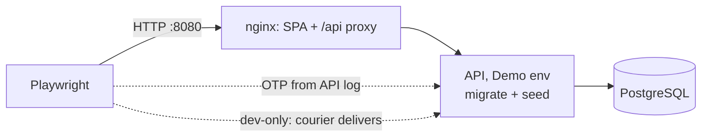

# 42 · Multi-stage Docker builds and an e2e strategy that does not flake (#38)

## The idea in plain words

**Multi-stage build** = a restaurant: you cook in a kitchen full of tools (SDK, node, compilers), then carry
only the plate to the table. The build stage has everything needed to *make* the app; the runtime stage gets
only the result. Smaller image, fewer packages to patch, no compilers for an attacker to use.

**E2E test** = a mystery diner: one real customer, through the front door, start to finish. It proves the
parts fit (browser, nginx, API, database, jobs) but is slow and has many reasons to fail, so you keep few of
them and push every rule down to faster tests.

## What we built and why

| Decision | Why |
| --- | --- |
| Restore from `*.csproj` / `package-lock.json` before copying source | Docker caches the dependency layer; a code change does not re-download NuGet/npm. |
| Runtime: ASP.NET image + Chromium **headless shell** only, non-root user | Labels need a browser (ADR 0008); the full browser is ~400 MB more and never launched. |
| nginx proxies `/api` | One origin: the HttpOnly refresh cookie works exactly as with Vite in development. |
| `profiles: [app]` | `docker compose up -d` for developers is unchanged; the product is opt-in. |
| Health checks + `depends_on: service_healthy` + `--wait` | "Started" is not "ready": the test begins only when `/health` says the database is reachable. |
| Dev-only Fake courier endpoint | A real courier moves parcels; in a container nobody can. The route exists only in Development/Demo. |

**Against flakiness:** no `sleep`: every step waits for a visible state or a specific response; each run creates
its own order and customer; one retry in CI, reported as *flaky* rather than hidden; traces, video and the
compose log are uploaded when it fails. One real lesson: the OTP rate limit (one code per phone per 30 s) made a
retry fail for an unrelated reason, so sign-in waits exactly the `Retry-After` the API returns.

## Interview questions

**1. What belongs in e2e tests versus integration tests?**
E2E: a handful of business-critical journeys across the deployed pieces (does the product work for a user?).
Integration: each API behaviour against a real database, with all edge cases (invalid transition, other tenant,
idempotent replay). If an e2e failure is the only test catching a rule, that rule needs a lower-level test.

**2. Why multi-stage builds?**
Build tools stay out of the shipped image: smaller pulls, smaller attack surface, fewer CVEs to patch, and
cached layers make rebuilds fast. The runtime stage is also where you drop to a non-root user.

**3. How do you keep e2e tests from being flaky?**
Wait for states, not time; isolate data per run; make the environment ready before starting (health checks);
remove external dependencies (fake courier, OTP from logs); allow at most one retry and track flaky reports;
keep traces so a failure is diagnosable without re-running.
