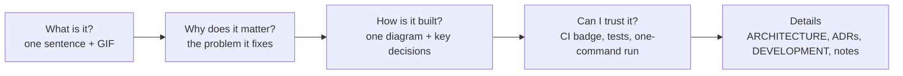

# 43 · Technical storytelling: a README that sells in 60 seconds (#39)

## The idea in plain words

A README is a shop window, not a stock room. Someone walking past (a hiring manager, a new contributor) decides
in seconds whether to step in. The window has to answer four questions in order, and leave the details one
click away:

## What we did and why

| Choice | Reason |
| --- | --- |
| Lead with the user's problem ("where money leaks"), not the stack | A reviewer remembers a story, not a list of libraries; the stack shows up in the diagram anyway. |
| A short GIF of one real journey | Proves the product works end to end in 10 seconds; nobody reads setup steps to find that out. |
| Screenshots from a **script** against the demo shop | They never go stale or show fake-looking data: `npm run readme:media` re-shoots everything after a UI change. Taken *before* the GIF creates its order, so lists show only the seeded data. |
| Decisions as a table with ADR links | Shows judgement (why, not just what), and each row is an interview conversation ready to happen. |
| Setup moved to `docs/DEVELOPMENT.md` | The README stays skimmable; the one command that matters (`docker compose --profile app up`) stays on the front page. |
| Honest claims | "About 710 tests", "optional AI", "no SMS gateway yet": overselling is found out in the first interview question. |

**The two-minute architecture walk-through** (the interview angle) follows the README's order: the problem
(three money leaks), the shape (modular monolith, Clean Architecture, one database with tenant filters), the
interesting part (order state machine, idempotent courier bookings, COD matching), how it is kept correct (test
levels, tenant isolation tests, e2e on the containers), and what you would change at scale (split the courier
sync out, read replicas for reports, a proper SMS gateway).

## Interview questions

**1. Walk me through the architecture of your project in two minutes.**
Problem first, then the shape (modular monolith, Clean Architecture, shared-database multi-tenancy), one or two
hard parts with their trade-offs (idempotent courier bookings, payout matching), how correctness is protected
(tests at each level), and what you would change at ten times the scale.

**2. What would you change if the system had to scale 10x?**
Move the courier status sync to its own worker, add read replicas or a reporting store for dashboards, partition
large tables by tenant and time, and put an SMS gateway and a queue behind OTP delivery: the module seams make
each of these a local change.

**3. How do you keep documentation from going stale?**
Generate what can be generated (OpenAPI client, screenshots from a script), test what can be tested (a snapshot of
the API contract, link checks), record decisions when they are made (ADRs), and keep the README short enough
that someone actually updates it.
