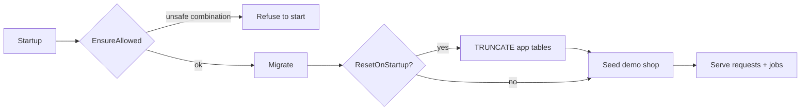

# 44 — Fail-closed demo switches and disposable demo data

## The concept
A hosted demo needs two things a real product must never have: a **sign-in with no password or code**, and a
**button that deletes all the data**. The safe way to build them is *fail closed*: every lock defaults to "off",
any doubt means "refuse", and the refusal happens **at startup**, where a mistake is loud, not at 3 AM in production.

**Analogy:** a show flat in a new building. The front door has no lock, and the cleaners strip it every morning.
That is fine because it is a show flat: the builder never hands out show-flat keys for real homes, and the
cleaners refuse to work in any flat without the "SHOW FLAT" sign on the door.

## Why we built it this way
- **Two locks on the login.** The `[DevOnly]` convention removes the route outside Development/Demo (it does not
  exist in production: 404, not in OpenAPI), and inside them it still answers 404 until `Demo:Login` is on.
  It can only reach the demo phone block (`+880 10 0000 0xxx`), so even a misconfiguration cannot open a seller's
  account.
- **`EnsureAllowed` at startup.** Demo login/seed outside the allow-list, reset outside `Demo` (not even
  Development: your local data is not disposable), or reset without seed: the app refuses to start.
- **Reset on startup, not at night.** The seeder moves one shared clock back in time to write a month of history.
  That is only safe before the server takes requests. Render's free tier sleeps after 15 minutes idle, so a
  startup reset gives most visitors fresh data without the clock race.
- **TRUNCATE from the EF model.** One `TRUNCATE ... CASCADE` over every table the model knows: a new entity is
  covered automatically, and the test checks the real `pg_tables`, so a table the model forgot would fail it.

## Interview questions
1. **How do you stop a demo backdoor from reaching production?**
   Several independent locks, all off by default: an environment allow-list (not a deny-list, so a typo fails
   closed), an explicit flag, a startup check that throws, and a scope limit (only fictional demo users). Tests
   prove the route answers 404 in other environments.
2. **Why validate configuration at startup instead of on each request?**
   A bad setting found at startup stops the deploy before any user is affected, and the health check fails
   loudly. A per-request check lets a broken instance serve traffic, and its error appears only when someone
   happens to hit it.
3. **Why not run the reset as a nightly background job?**
   The seeder changes process-wide state (the clock) while it runs. Doing that while requests are being served
   would stamp visitors' orders and token expiry times with past dates. Either make that state per-flow
   (AsyncLocal) or run the reset where nothing else runs yet: at startup.
