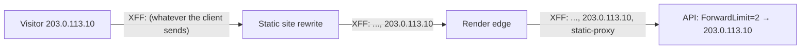

# 45 — Deploying behind proxies, on a small budget

## The concept
Three ideas make a free deployment work:
1. **Infrastructure as code.** `render.yaml` describes the services, their settings and which secrets they
   need. The setup can be reviewed in a PR and rebuilt in ten minutes, and secrets never appear in it.
2. **Trusting proxies by count, not by address.** Behind proxies, the TCP peer is the proxy. Each proxy
   appends the address it saw to `X-Forwarded-For`. The app trusts exactly as many entries from the right
   as there are proxies it controls; anything further left was written by the client and can be fake.
3. **Fitting a memory budget.** .NET sizes its heap from the container limit, but Chromium is a separate
   process sharing the same 512 MB. So we cap the heap, use workstation GC and print one PDF at a time.

**Analogy:** a parcel passes two sorting hubs, and each hub stamps the label with where the parcel came
from. You trust the last two stamps because your own hubs made them. Anything written above them, the
sender could have written themselves.

## Why we used it here
- The per-IP limits on OTP and the demo button would otherwise put every visitor in one bucket, so one
  busy visitor locks everyone out (a denial of service by accident).
- With `ForwardLimit=2` the tests prove two visitors behind the same proxy get separate limits, and that
  writing your own `X-Forwarded-For` does not reset yours.
- The static site rewrites `/api/*` to the API, so the browser sees one origin and the `SameSite=Strict`,
  HttpOnly refresh cookie keeps working. Two `onrender.com` subdomains count as different sites.

## Interview questions
1. **Why not just trust the leftmost `X-Forwarded-For` entry?**
   The client writes it. Anyone could send a new fake address on each request and get past every per-IP
   limit. Only entries added by your own proxies can be trusted, counted from the right.
2. **What changes between this demo deployment and production?**
   An always-on instance (no cold start), more than one instance with migrations as a pipeline step,
   managed backups and point-in-time restore, a real SMS gateway, monitoring and alerts, secrets in a
   vault with rotation, and the demo switches off (startup refuses them outside Demo anyway).
3. **Why cap the .NET heap when the container already has a memory limit?**
   The runtime assumes the whole container limit is its own. Chromium runs as a separate process in the
   same container, so without a cap the GC lets the heap grow until the kernel OOM-kills the container,
   usually in the middle of printing a PDF.
